# SQL Queries: Evidence

**Mini Project 1: Northwest Architecture Studio** · Marcus Weeks (Architect / CAD Designer build)

Every query below was run on OneCompiler (MySQL) on 29/09/2026, on the database built from the brief's ER diagram (page 8). Each picture shows the query and its result, cut from the full OneCompiler screenshot so the text can be read. The full screenshot is linked under each picture.

Queries 5, 6 and 7 in the brief ask about build number 1. This database only holds the CAD build's parts so far (build 3), so they are run on build 3. They work the same way on build 1 once those parts are added.

---

## Part A: Reading single tables

### Query 1: List every role
```sql
SELECT * FROM EmployeeRoles;
```
Shows every column for all 4 roles. The `*` means "every column".

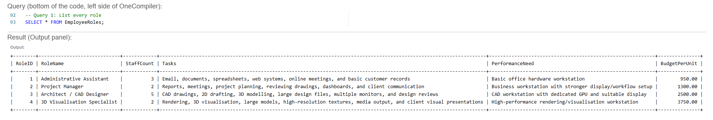

[Full screenshot](Evidence/SQL_Queries/Q01.png)

### Query 2: Just the names and budgets
```sql
SELECT RoleName, BudgetPerUnit FROM EmployeeRoles;
```
Shows only the 2 columns asked for: the role name and its budget per workstation.

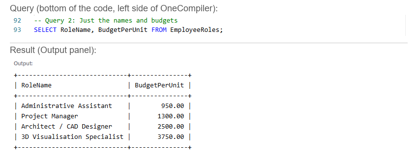

[Full screenshot](Evidence/SQL_Queries/Q02.png)

### Query 3: The higher-budget roles
```sql
SELECT RoleName, BudgetPerUnit FROM EmployeeRoles WHERE BudgetPerUnit > 1000;
```
`WHERE` keeps only the rows that match. 3 roles have a budget over £1,000. The Administrative Assistant (£950) drops out.

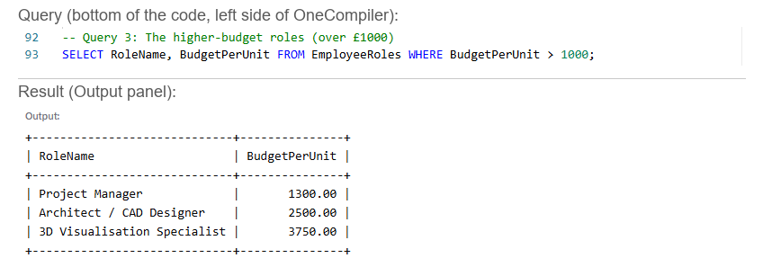

[Full screenshot](Evidence/SQL_Queries/Q03.png)

### Query 4: Roles by team size
```sql
SELECT RoleName, StaffCount FROM EmployeeRoles ORDER BY StaffCount DESC;
```
`ORDER BY ... DESC` sorts from biggest to smallest. The CAD Designers come first with 5 staff.

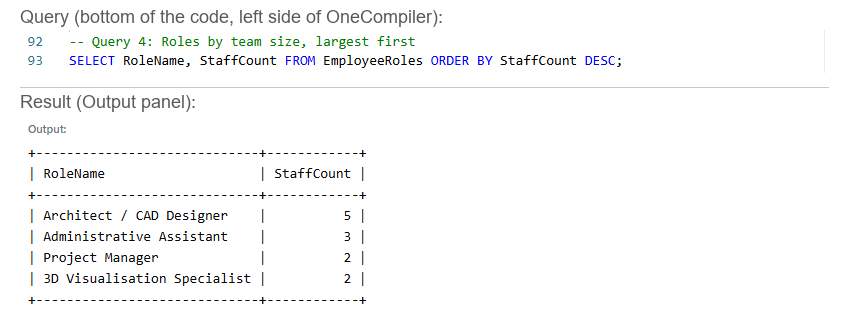

[Full screenshot](Evidence/SQL_Queries/Q04.png)

### Query 5: Find one build's items
```sql
SELECT * FROM BuildItems WHERE BuildID = 3;
```
Lists all 14 items in the CAD build, with category, name, specification and cost.

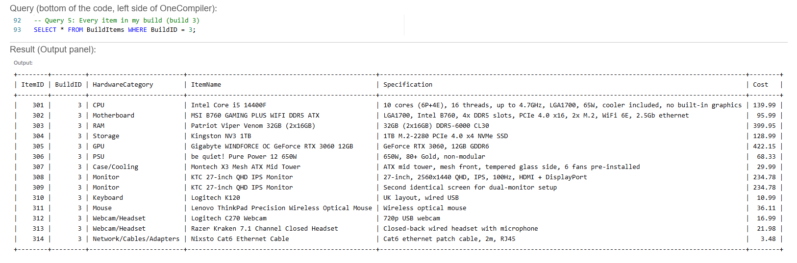

[Full screenshot](Evidence/SQL_Queries/Q05.png)

### Query 6: Count the items in a build
```sql
SELECT COUNT(*) AS ItemCount FROM BuildItems WHERE BuildID = 3;
```
`COUNT(*)` counts the rows. The CAD build has 14 items. `AS` gives the answer column a clear name.

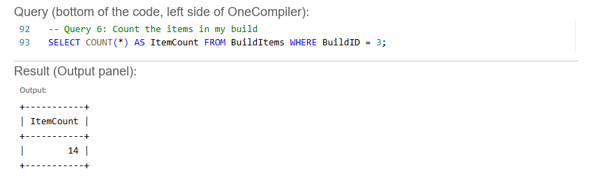

[Full screenshot](Evidence/SQL_Queries/Q06.png)

## Part B: Totals and summaries

### Query 7: Total cost of one build
```sql
SELECT SUM(Cost) AS TotalCost FROM BuildItems WHERE BuildID = 3;
```
`SUM` adds up the Cost column. One CAD workstation costs £1,844.50.

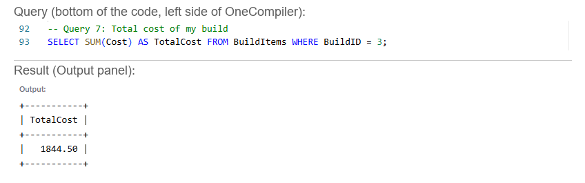

[Full screenshot](Evidence/SQL_Queries/Q07.png)

### Query 8: Cost of every build
```sql
SELECT BuildID, SUM(Cost) AS TotalCost FROM BuildItems GROUP BY BuildID ORDER BY TotalCost DESC;
```
`GROUP BY` gives one total per build, and `ORDER BY ... DESC` puts the most expensive first. Only build 3 has parts so far, so it shows one row.

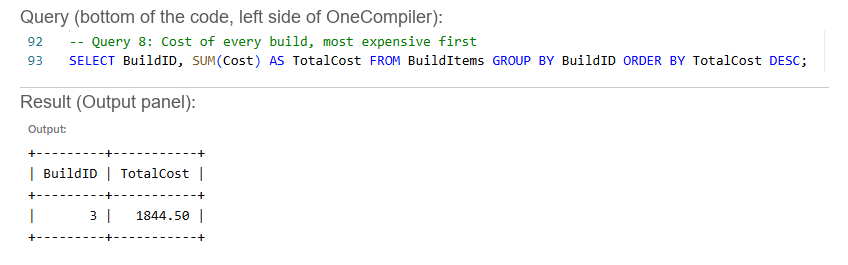

[Full screenshot](Evidence/SQL_Queries/Q08.png)

## Part C: Across tables with JOINs

### Query 9: Which role is each build for?
```sql
SELECT b.BuildName, r.RoleName
FROM WorkstationBuilds b
JOIN EmployeeRoles r ON b.RoleID = r.RoleID;
```
The build names and role names live in different tables. `JOIN` matches them up using the RoleID they share. `b` and `r` are short nicknames for the 2 tables.

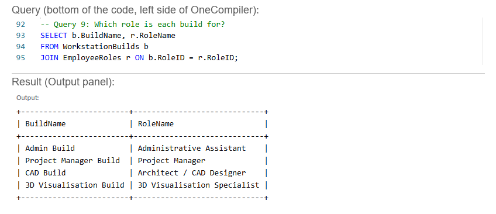

[Full screenshot](Evidence/SQL_Queries/Q09.png)

### Query 10: Items with their build and role
```sql
SELECT i.ItemName, b.BuildName, r.RoleName
FROM BuildItems i
JOIN WorkstationBuilds b ON i.BuildID = b.BuildID
JOIN EmployeeRoles r ON b.RoleID = r.RoleID;
```
Links 3 tables. Each item points to its build, and each build points to its role, so every part shows which build and which role it belongs to.

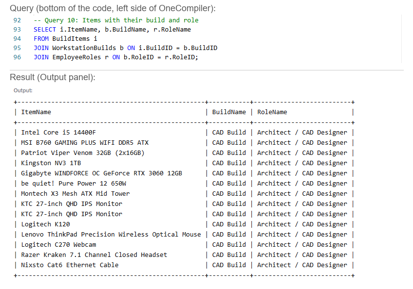

[Full screenshot](Evidence/SQL_Queries/Q10.png)

### Query 11: Spend per role
```sql
SELECT r.RoleName, SUM(i.Cost) AS TotalSpend
FROM BuildItems i
JOIN WorkstationBuilds b ON i.BuildID = b.BuildID
JOIN EmployeeRoles r ON b.RoleID = r.RoleID
GROUP BY r.RoleName;
```
Combines a JOIN with SUM and GROUP BY to total the hardware cost for each role. The CAD role comes to £1,844.50 per workstation.

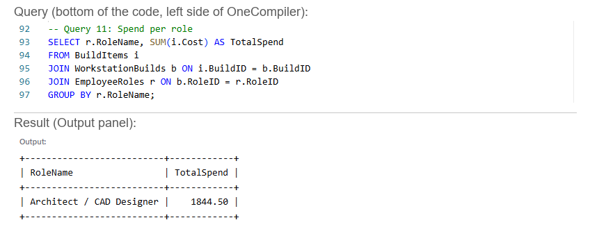

[Full screenshot](Evidence/SQL_Queries/Q11.png)

---

## Extra: role totals against the budget

```sql
SELECT r.RoleName,
       r.StaffCount,
       SUM(i.Cost) AS CostPerPC,
       SUM(i.Cost) * r.StaffCount AS RoleTotal,
       r.BudgetPerUnit * r.StaffCount AS RoleBudget
FROM BuildItems i
JOIN WorkstationBuilds b ON i.BuildID = b.BuildID
JOIN EmployeeRoles r ON b.RoleID = r.RoleID
GROUP BY r.RoleID, r.RoleName, r.StaffCount, r.BudgetPerUnit;
```
Multiplies the cost of one workstation by the number of staff. 5 CAD workstations cost £9,222.50 against a role budget of £12,500.

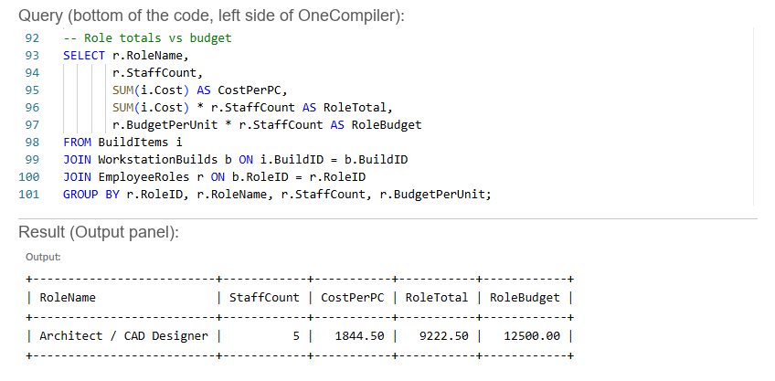

[Full screenshot](Evidence/SQL_Queries/Role_totals.png)

## Checking the other tables

The brief asks for every table to be queried at least once.

```sql
SELECT * FROM WorkstationBuilds;
```
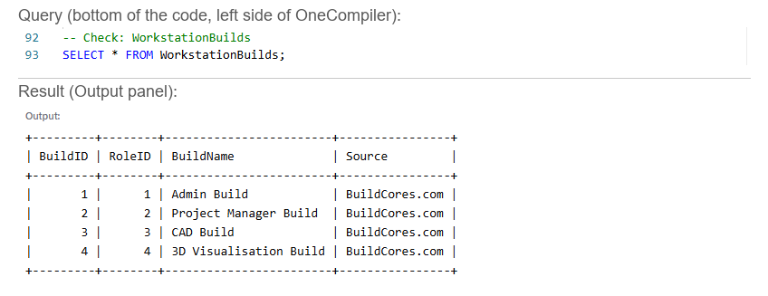

[Full screenshot](Evidence/SQL_Queries/Check_WorkstationBuilds.png)

```sql
SELECT * FROM Recommendations;
```
The Justification, Compromise and EthicalNotes columns hold full paragraphs. The result is wrapped onto several lines so every word shows, which is why the table lines break across the screen. All 6 columns are there: RecommendationID 3, RoleID 3, the three paragraphs, and Approved = 1 (yes).

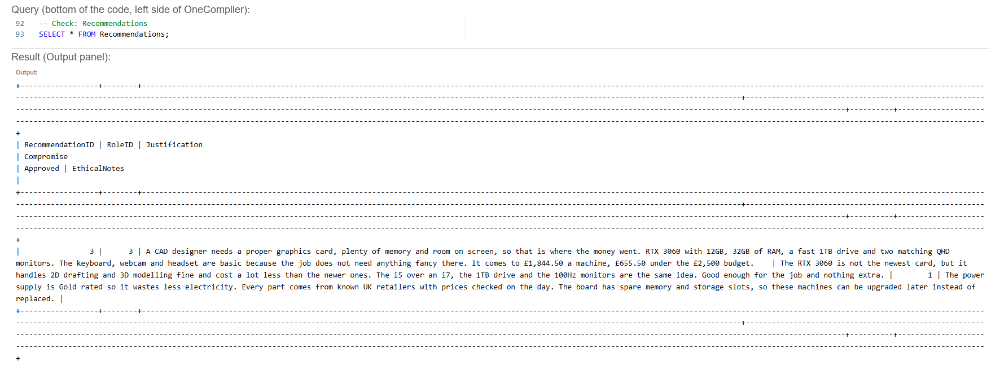

[Full screenshot](Evidence/SQL_Queries/Check_Recommendations.png)

---

## Data integrity: how the database stops bad data

The brief's data integrity rules (page 9) are built into the tables themselves, so the database refuses bad data instead of storing it. Each rule below was tested on OneCompiler by trying to add a bad row on purpose.

**Unique IDs.** Every table has a `PRIMARY KEY`: RoleID, BuildID, ItemID and RecommendationID. No two rows can share one, so two parts can never get mixed up. Adding a second item with ItemID 301 was refused.

```sql
INSERT INTO BuildItems (ItemID, BuildID, HardwareCategory, ItemName, Specification, Cost)
VALUES (301, 3, 'Mouse', 'Test mouse', 'Test', 9.99);
```
Result: `ERROR 1062: Duplicate entry '301' for key 'builditems.PRIMARY'`

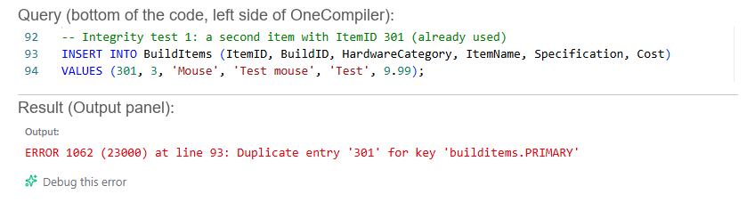

[Full screenshot](Evidence/SQL_Queries/Integrity_1_duplicate_ID.png)

**Links must point to something real.** Each `FOREIGN KEY` checks the other table. A part has to belong to a build that exists, and every build and recommendation has to belong to a real role. Adding a part to build 9, which doesn't exist, was refused.

```sql
INSERT INTO BuildItems (ItemID, BuildID, HardwareCategory, ItemName, Specification, Cost)
VALUES (999, 9, 'Mouse', 'Test mouse', 'Test', 9.99);
```
Result: `ERROR 1452: Cannot add or update a child row: a foreign key constraint fails`

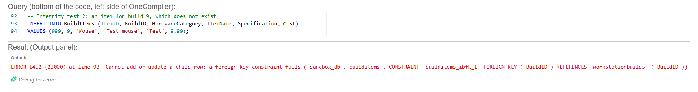

[Full screenshot](Evidence/SQL_Queries/Integrity_2_missing_build.png)

**Required fields can't be blank.** Every column is `NOT NULL`, which covers the ones the brief names: role name, hardware category, item name, cost and justification. Adding a part with no name was refused.

```sql
INSERT INTO BuildItems (ItemID, BuildID, HardwareCategory, ItemName, Specification, Cost)
VALUES (998, 3, 'Mouse', NULL, 'Test', 9.99);
```
Result: `ERROR 1048: Column 'ItemName' cannot be null`

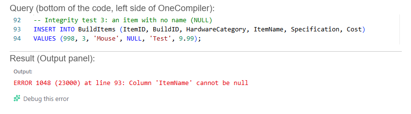

[Full screenshot](Evidence/SQL_Queries/Integrity_3_blank_name.png)

**Costs must be numbers.** Cost is `DECIMAL(8,2)`, which stores money to the exact penny, so `SUM` can add it up. A cost written as a word was refused.

```sql
INSERT INTO BuildItems (ItemID, BuildID, HardwareCategory, ItemName, Specification, Cost)
VALUES (997, 3, 'Mouse', 'Test mouse', 'Test', 'cheap');
```
Result: `ERROR 1366: Incorrect decimal value: 'cheap' for column 'Cost'`

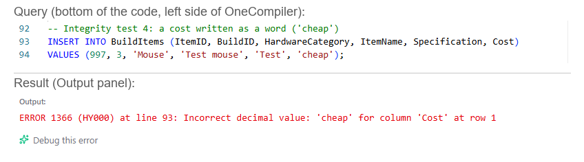

[Full screenshot](Evidence/SQL_Queries/Integrity_4_cost_as_word.png)

**Consistent category names.** Every part uses one of the same names, following the brief's list: CPU, Motherboard, RAM, Storage, GPU, PSU, Case/Cooling, Monitor, Keyboard, Mouse, Webcam/Headset and Network/Cables/Adapters. A misspelling like "Moniter" would be counted as its own category and throw out `COUNT` and `GROUP BY` totals. The database doesn't block this one by itself, so it depends on everyone in the team using the same list.

**Team numbering.** Each member's ItemIDs start from their build number: Admin 101 onwards, Project Manager 201, CAD 301, 3D Visualisation 401. Everyone can add parts to the same table without their IDs clashing.

---

## Checklist (brief pages 9 to 12)

- [x] Every table queried: EmployeeRoles, WorkstationBuilds, BuildItems, Recommendations
- [x] Used at least once: SELECT, WHERE, ORDER BY, COUNT, SUM, GROUP BY, JOIN
- [x] A screenshot of every result
- [x] Each query explained
- [x] Data integrity explained, with tested examples (unique IDs, valid links, required fields, numeric costs, consistent categories)
