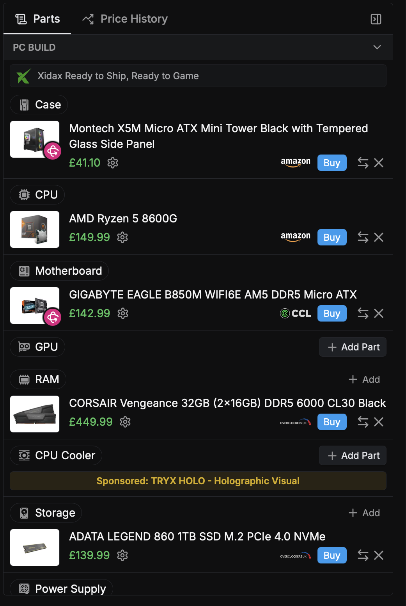
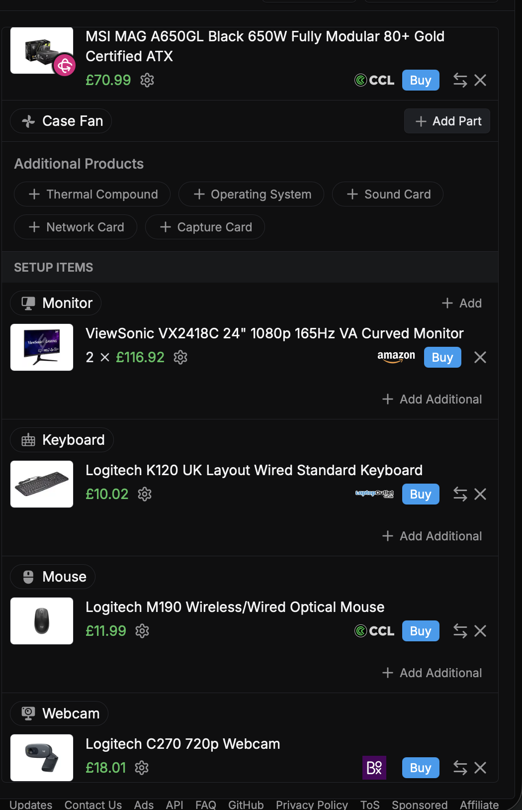
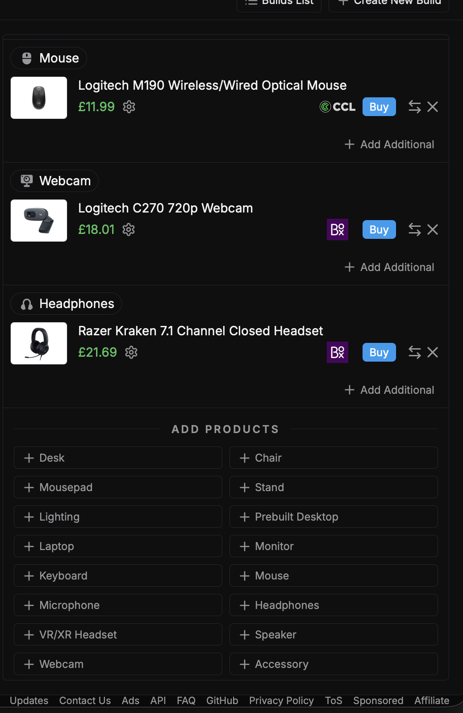

# Team Work Allocation

**SQL Database — Recommended Hardware Workstations**

| | |
|---|---|
| **Team name** |The Avengers|
| **Repository** |com4401-2026-ga8-4|
| **Deadline** | |
| **How we'll keep in touch** | *(e.g. group chat, weekly check-in)* |

---

## 1. Who's doing what

| Member | Build / area owned | What they'll deliver |
|--------|--------------------|----------------------|
|Sorana| Administrative Assistant build |
Basic office hardware workstation with email, documents, spreadsheets, web systems, online meetings, and basic customer records. 
|

BuildCores Parts List: [Link](https://uk.buildcores.com/builds/zT9H0Zxkz?share=true)

|**Component**|**Title**|**Price**|**Justification**|
|:-|:-|:-|:-|
|Case|[Montech X5M Micro ATX Mini Tower White with Tempered Glass Side Panel](https://uk.buildcores.com/products/PCCase/cgc8kt8wz/Montech-X5M-Micro-ATX-Mini-Tower-White-with-Tempered-Glass-Side-Panel)|[£24.98 (ScanComputer)](https://www.awin1.com/cread.php?awinmid=15473&awinaffid=743627&ued=https%3A%2F%2Fwww.scan.co.uk%2Fproducts%2Fmontech-x5m-white-matx-chassis-tempered-glass-4-x-120mm-argb-fans-usb-30-matx-mitx)|Cheapest case that fits the motherboard and takes a standard PSU. No need for anything bigger on an office PC.|
|CPU|[AMD Ryzen 5 8500G](https://uk.buildcores.com/products/CPU/ljuu2xfvq/AMD-Ryzen-5-8500G)|[£129.99 (CCL)](https://ccl.pxf.io/c/2299452/1991091/24481?prodsku=CPU0898&u=https%3A%2F%2Fwww.cclonline.com%2F100-100000931box-amd-ryzen-5-8500g-3-7ghz-hexa-core-am5-cpu-437729%2F&intsrc=CATF_16482)|Graphics and cooler are built in, so nothing extra to buy. Six cores run Office, browser tabs and a video call together without slowing down.|
|Motherboard|[Gigabyte A620 S2H DDR5 Micro ATX](https://uk.buildcores.com/products/Motherboard/u7e25ev5v/Gigabyte-A620-S2H-DDR5-Micro-ATX)|[£77.90 (Amazon)](https://www.amazon.co.uk/dp/B0C4CKFV65?tag=buildcoresx-21&linkCode=ogi&th=1&psc=1)|Cheapest board that fits the CPU. Has HDMI and wired ethernet built in, so no extra card is needed.|
|RAM|[Kingston FURY Beast Black DDR5-5600 CL40 16GB (2x8GB)](https://uk.buildcores.com/products/RAM/c6ju0668h/Kingston-FURY-Beast-Black-DDR5-5600-CL40-16GB-(2x8GB))|[£239.99 (Overclockers)](https://www.awin1.com/cread.php?awinmid=28821&awinaffid=743627&campaign=BuildCores&ued=https%3A%2F%2Fwww.overclockers.co.uk%2Fkingston-fury-beast-16gb-2x8gb-ddr5-pc5-44800c40-5600mhz-dual-channel-kit-my-29m-ks.html)|16GB across two sticks covers heavy multitasking. Two sticks run faster than one for the same money.|
|Storage|[PNY CS2230 500GB M.2-2280 SSD PCIe 3.0 x4 NVMe](https://uk.buildcores.com/products/Storage/0h6njl5nf/PNY-CS2230-500GB-M.2-2280-SSD-PCIe-3.0-x4-NVMe)|[£81.92 (Amazon)](https://www.amazon.co.uk/dp/B0BS2MPYG1?tag=buildcoresx-21&linkCode=ogi&th=1&psc=1)|Fast NVMe drive means quick startup and no waiting on files. 500GB is enough since files mainly live in SharePoint/OneDrive.|
|Power Supply|[Corsair CX (2023) Black 550W Non-Modular 80+ Bronze Certified](https://uk.buildcores.com/products/PSU/kn1pf6tl6/Corsair-CX-(2023)-Black-550W-Non-Modular-80%2B-Bronze-Certified)|[£49.00 (Computer Orbit)](https://computerorbit.com/products/550w-corsair-cx550-80-bronze-power-supply?ref=buildcores)|Well-known, reliable brand at the cheapest available price. A good PSU cuts the risk of failure, which causes downtime.|
|Monitor|[Dell 24 Monitor S2425H](https://uk.buildcores.com/products/Monitor/s2tpetvvu/Dell-24-Monitor-S2425H)|[£129.99 (Amazon)](https://www.amazon.co.uk/dp/B0CZ1RNXCY?tag=buildcoresx-21&linkCode=ogi&th=1&psc=1)|Business-grade screen, sharp enough for documents and spreadsheets. HDMI matches the motherboard, so no graphics card is needed.|
|Keyboard|[Logitech K120 UK Layout Wired Standard Keyboard](https://uk.buildcores.com/products/Keyboard/7xf62wlvo/Logitech-K120-UK-Layout-Wired-Standard-Keyboard)|[£10.99 (ScanComputer)](https://www.awin1.com/cread.php?awinmid=15473&awinaffid=743627&ued=https%3A%2F%2Fwww.scan.co.uk%2Fproducts%2Flogitech-k120-wired-keyboard-full-size-black-membrane-switches-spill-resistant-usb-uk)|Cheapest reliable option, correct UK layout. No extra features this role doesn't need.|
|Mouse|[HP QY777AA Optical Wired Mouse](https://uk.buildcores.com/products/Mouse/7xl0zingx/HP-QY777AA-Optical-Wired-Mouse)|[£21.60 (Amazon)](https://www.amazon.co.uk/dp/B008968NG0?tag=buildcoresx-21&linkCode=ogi&th=1&psc=1)|Plain wired mouse from a trusted business brand, matching the rest of the build.|
|Webcam|[Logitech C270 720p Webcam](https://uk.buildcores.com/products/Webcam/8ypgductv/Logitech-C270-720p-Webcam)|[£16.99 (CCL)](https://ccl.pxf.io/c/2299452/1991091/24481?prodsku=WBC0228&u=https%3A%2F%2Fwww.cclonline.com%2F960-001063-logitech-c270-hd-webcam-black-%2F&intsrc=CATF_16482)|Trusted brand at the cheapest price. 720p is enough clarity for office video calls.|
|Headphones|[Razer Kraken 7.1 Channel Closed Headset](https://uk.buildcores.com/products/Headphones/ebjsc5c5c/Razer-Kraken-7.1-Channel-Closed-Headset)|[£21.98 (Box.co)](https://www.awin1.com/cread.php?awinmid=100685&awinaffid=743627&campaign=BuildCores&ued=https%3A%2F%2Fbox.co.uk%2Frz04-02950100-r381-razer-kraken-x-lite-7-1-wired)|Closed-back with a mic, cheapest suitable option for clear audio on calls.|
|Network Cable|Nixsto Cat6/Cat6e Ethernet Cable, 2m, flat, RJ45|£3.48 (Amazon)|Motherboard has wired ethernet built in, so only a patch cable is needed to connect to the office network point.|
| | | | |
|**Total Price**|**£808.81**| | |
|[BuildCores Web](https://uk.buildcores.com)|[BuildCores iOS](https://apps.apple.com/us/app/buildcores-part-picker-for-pc/id1441971434)|[BuildCores Android](https://play.google.com/store/apps/details?id=com.buildcores.buildcores&pcampaignid=web_share)|

| Member | Build / area owned | What they'll deliver |
|--------|--------------------|----------------------|
|Nah| Project Manager build (taken over from Mo) |
Business hardware workstation with a stronger display/workflow setup (two monitors) for reports, meetings, project planning, reviewing drawings, dashboards and client communication.
|

Full BuildCores screenshots: [part 1](PM_Build_Evidence/PM_Build_1.png) · [part 2](PM_Build_Evidence/PM_Build_2.png) · [part 3](PM_Build_Evidence/PM_Build_3.png)

BuildCores Parts List: [Link](https://uk.buildcores.com/builds/-2koTmVPS?share=true)

|**Component**|**Title**|**Price**|**Justification**|
|:-|:-|:-|:-|
|CPU|[AMD Ryzen 5 8600G](https://uk.buildcores.com/products/CPU/r914uuvqu/AMD-Ryzen-5-8600G)|[£149.99 (Amazon)](https://www.amazon.co.uk/dp/B0CQ4GYTTX?tag=buildcoresx-21&linkCode=ogi&th=1&psc=1)|A Project Manager works with emails, reports, video calls and dashboards, often at the same time, so the 6 cores are enough to run them all at once without slowing down. It also has built-in graphics, so no separate graphics card is needed, which saves money for better monitors.|
|Motherboard|[GIGABYTE EAGLE B850M WIFI6E AM5 DDR5 Micro ATX](https://uk.buildcores.com/products/Motherboard/x61x7ovyp/GIGABYTE-EAGLE-B850M-WIFI6E-AM5-DDR5-Micro-ATX)|[£142.99 (CCL)](https://ccl.pxf.io/c/2299452/1991091/24481?prodsku=MBD3989&u=https%3A%2F%2Fwww.cclonline.com%2Fb850m-eagle-wifi6e-gigabyte-b850m-eagle-wifi6e-motherboard-cpus%2F&intsrc=CATF_16482)|The motherboard has an AM5 socket, so it fits the Ryzen 5 8600G CPU. It has 3 video ports (1 HDMI and 2 DisplayPort), so both monitors can plug straight into the motherboard, without needing a graphics card.|
|RAM|[CORSAIR Vengeance 32GB (2x16GB) DDR5 6000 CL30 Black](https://uk.buildcores.com/products/RAM/ef8se7q7s/CORSAIR-Vengeance-32GB-(2x16GB)-DDR5-6000-CL30-Black)|[£449.99 (Overclockers UK)](https://www.awin1.com/cread.php?awinmid=28821&awinaffid=743627&campaign=BuildCores&ued=https%3A%2F%2Fwww.overclockers.co.uk%2Fcorsair-vengeance-xmp-32gb-2x16gb-ddr5-pc5-48000c30-6000mhz-dual-channel-mem-crs-01125.html)|The Project Manager has lots open at once, like emails, reports, dashboards and video calls, so 32GB of RAM lets them all run smoothly at the same time. They also review drawings, which can be large files, so the extra memory stops the computer slowing down when opening them.|
|Storage|[ADATA LEGEND 860 1TB SSD M.2 PCIe 4.0 NVMe](https://uk.buildcores.com/products/Storage/9byyzf2dn/ADATA-LEGEND-860-1TB-SSD-M.2-PCIe-4.0-NVMe)|[£139.99 (Overclockers UK)](https://www.awin1.com/cread.php?awinmid=28821&awinaffid=743627&campaign=BuildCores&ued=https%3A%2F%2Fwww.overclockers.co.uk%2Fadata-860-1tb-pcie-4.0-nvme-m.2-solid-state-drive-sto-ada-07787.html)|1TB gives plenty of space for reports, spreadsheets and drawings to review, without paying for more than they need.|
|Power Supply|[MSI MAG A650GL Black 650W Fully Modular 80+ Gold Certified ATX](https://uk.buildcores.com/products/PSU/unn6lswmr/MSI-MAG-A650GL-Black-650W-Fully-Modular-80%2B-Gold-Certified-ATX)|[£70.99 (CCL)](https://ccl.pxf.io/c/2299452/1991091/24481?prodsku=PSU2298&u=https%3A%2F%2Fwww.cclonline.com%2Fmag-a650gl-msi-mag-a650gl-650w-modular-80-plus-gold-power-supply-455158%2F&intsrc=CATF_16482)|650W is more than enough for this build, which has no graphics card, with room to spare.|
|Case|[Montech X5M Micro ATX Mini Tower Black with Tempered Glass Side Panel](https://uk.buildcores.com/products/PCCase/zboqjyf2c/Montech-X5M-Micro-ATX-Mini-Tower-Black-with-Tempered-Glass-Side-Panel)|[£41.10 (Amazon)](https://www.amazon.co.uk/dp/B0FF8NWT6F?tag=buildcoresx-21&linkCode=ogi&th=1&psc=1)|It fits the Micro ATX motherboard.|
|Monitor|[ViewSonic VX2418C 24" 1080p 165Hz VA Curved Monitor](https://uk.buildcores.com/products/Monitor/4c70n7jv4/ViewSonic-VX2418C-24%22-1080p-165Hz-VA-Curved-Monitor)|[£116.92 (Amazon)](https://www.amazon.co.uk/dp/B09NVXM1T3?tag=buildcoresx-21&linkCode=ogi&th=1&psc=1)|Two 24-inch screens let the Project Manager have reports, dashboards and video calls open side by side.|
|Monitor|[ViewSonic VX2418C 24" 1080p 165Hz VA Curved Monitor](https://uk.buildcores.com/products/Monitor/4c70n7jv4/ViewSonic-VX2418C-24%22-1080p-165Hz-VA-Curved-Monitor)|[£116.92 (Amazon)](https://www.amazon.co.uk/dp/B09NVXM1T3?tag=buildcoresx-21&linkCode=ogi&th=1&psc=1)|Second, identical monitor for the two-screen setup, so both screens match.|
|Keyboard|[Logitech K120 UK Layout Wired Standard Keyboard](https://uk.buildcores.com/products/Keyboard/7xf62wlvo/Logitech-K120-UK-Layout-Wired-Standard-Keyboard)|[£10.02 (Laptop Outlet)](https://www.awin1.com/cread.php?awinmid=111534&awinaffid=743627&campaign=BuildCores&ued=https%3A%2F%2Fwww.laptopoutlet.co.uk%2Flogitech-k120-wired-keyboard-usb-qwerty-uk-english-layout-black.html)|It has a UK layout, so the keys match what UK staff are used to. It is a full-size keyboard with a number pad, which is useful for typing figures into budgets and spreadsheets. It is reliable and low-cost, which leaves budget for the parts that matter more, like the monitors.|
|Mouse|[Logitech M190 Wireless/Wired Optical Mouse](https://uk.buildcores.com/products/Mouse/d7gv42ejp/Logitech-M190-Wireless%2FWired-Optical-Mouse)|[£11.99 (CCL)](https://ccl.pxf.io/c/2299452/1991091/24481?prodsku=MOU3567&u=https%3A%2F%2Fwww.cclonline.com%2F910-005905-logitech-m190-full-size-wireless-mouse-in-charcoal-402561%2F&intsrc=CATF_16482)|It is a full-size mouse, so it is comfortable to use all day. It is wireless, which keeps the desk tidy with two monitors and lots of cables. It is from a trusted brand and low-cost, which keeps the build within budget.|
|Webcam|[Logitech C270 720p Webcam](https://uk.buildcores.com/products/Webcam/8ypgductv/Logitech-C270-720p-Webcam)|[£18.01 (Box.co.uk)](https://www.awin1.com/cread.php?awinmid=100685&awinaffid=743627&campaign=BuildCores&ued=https%3A%2F%2Fbox.co.uk%2F960-001063-logitech-c270-usb-30fps-webcam-grey)|The Project Manager has meetings and client calls, so a webcam is needed for video calls. 720p is clear enough for video calls, and it is low-cost, which keeps the build within budget. It is from a trusted brand, Logitech, so it is reliable.|
|Headphones|[Razer Kraken 7.1 Channel Closed Headset](https://uk.buildcores.com/products/Headphones/ebjsc5c5c/Razer-Kraken-7.1-Channel-Closed-Headset)|[£21.69 (Box.co.uk)](https://www.awin1.com/cread.php?awinmid=100685&awinaffid=743627&campaign=BuildCores&ued=https%3A%2F%2Fbox.co.uk%2Frz04-02950100-r381-razer-kraken-x-lite-7-1-wired)|It has a built-in microphone, so the Project Manager can be heard clearly in meetings and client calls. It is closed-back, which blocks out office noise and keeps calls private. It is low-cost, which keeps the build within budget.|
|Network Cable|CSL - 2m CAT6 Ethernet LAN Cable - High-Speed Patch Cord - Gigabit RJ45 Network Lead 1000 Mbps - Black|[£5.99 (Amazon)*](https://www.amazon.co.uk/dp/B014FCC9CU)|The motherboard has wired ethernet built in, so only a cable is needed to connect to the office network. A wired connection is faster and more reliable than Wi-Fi for video calls and opening large files from the office server. It is low-cost, which keeps the build within budget.|
| | | | |
|**Total Price**|**£1,296.59**| | |
|[BuildCores Web](https://uk.buildcores.com)|[BuildCores iOS](https://apps.apple.com/us/app/buildcores-part-picker-for-pc/id1441971434)|[BuildCores Android](https://play.google.com/store/apps/details?id=com.buildcores.buildcores&pcampaignid=web_share)|

Prices were checked on 02/10/2026. The total of £1,296.59 is per workstation, £3.41 under the £1,300 budget per workstation (2 workstations = £2,593.18 against a £2,600 role budget). *The network cable is not listed on BuildCores, so its price was taken from the Amazon UK page; this is why the BuildCores total (£1,290.60) is £5.99 lower.

| Member | Build / area owned | What they'll deliver |
|--------|--------------------|----------------------|
|Marcus| Architect / CAD Designer build |
CAD hardware workstation with dedicated GPU and suitable display with CAD drawings, 2D drafting, 3D modelling, large design files, multiple monitors, and design reviews. 
|

|**Component**|**Title**|**Price**|**Justification**|
|:-|:-|:-|:-|
|Case|[Montech X3 Mesh ATX Mid Tower Black with Mesh, Tempered Glass Side Panel](https://uk.buildcores.com/products/PCCase/ozv3pdfxw/Montech-X3-Mesh-ATX-Mid-Tower-Black-with-Mesh%2C-Tempered-Glass-Side-Panel)|[£29.99 (ScanComputer)](https://www.awin1.com/cread.php?awinmid=15473&awinaffid=743627&ued=https%3A%2F%2Fwww.scan.co.uk%2Fproducts%2Fmontech-x3-mesh-black-atx-chassis-w-tempered-glass-3x-140mm-3x-120mm-rgb-haf-fans-usb32-atx-matx-mit)|Cheapest ATX case that fits the motherboard and the graphics card. Mesh front gives better airflow to help cool the GPU. Comes with 6 fans already installed, so no extra fans need buying.|
|CPU|[Intel Core i5 14400F](https://uk.buildcores.com/products/CPU/byp602jm1/Intel-Core-i5-14400F)|[£139.99 (Box.co)](https://www.awin1.com/cread.php?awinmid=100685&awinaffid=743627&campaign=BuildCores&ued=https%3A%2F%2Fbox.co.uk%2Fbx8071514400f-ag-intel-core-i5-14400f-processor)|10 cores/16 threads gives strong performance for CAD software and 3D modelling. The "F" version has no built-in graphics, which is fine since this build has a dedicated GPU, saving money over the non-F version.|
|Motherboard|[MSI B760 GAMING PLUS WIFI DDR5 ATX](https://uk.buildcores.com/products/Motherboard/ovus991a1/MSI-B760-GAMING-PLUS-WIFI-DDR5-ATX)|[£95.99 (Box.co)](https://www.awin1.com/cread.php?awinmid=100685&awinaffid=743627&campaign=BuildCores&ued=https%3A%2F%2Fbox.co.uk%2Fb760-gaming-plus-wifi-ag-msi-intel-b760-ddr5-atx)|Full ATX size gives room for the graphics card and future expansion. DDR5 matches the RAM. Fast wired ethernet suits large file transfers for CAD work.|
|GPU|[Gigabyte WINDFORCE OC GeForce RTX 3060 12GB 12GB GDDR6 Black](https://uk.buildcores.com/products/GPU/mjiwkintc/Gigabyte-WINDFORCE-OC-GeForce-RTX-3060-12GB-12GB-GDDR6-Black)|[£422.15 (Amazon)](https://www.amazon.co.uk/dp/B0CLF23DXB?tag=buildcoresx-21&linkCode=ogi&th=1&psc=1)|Real graphics card needed for 2D drafting and 3D modelling, unlike an office build. 12GB of memory handles larger 3D scenes well.|
|RAM|[Patriot Viper Venom 32GB (2x16GB) DDR5 6000 CL30 Black](https://uk.buildcores.com/products/RAM/3x2i76lbt/Patriot-Viper-Venom-32GB-(2x16GB)-DDR5-6000-CL30-Black)|[£399.95 (Overclockers)](https://www.awin1.com/cread.php?awinmid=28821&awinaffid=743627&campaign=BuildCores&ued=https%3A%2F%2Fwww.overclockers.co.uk%2Fpatriot-viper-venom-expo-32gb-2x16gb-ddr5-c30-6000mhz-dual-channel-kit-mem-pat-06805.html)|32GB covers CAD software and large design files running alongside other apps. Two sticks run in dual channel, faster than one for the same money.|
|Storage|[Kingston NV3 PCIe 4.0 NVMe SSD 2280 1TB](https://uk.buildcores.com/products/Storage/z5cannwxb/Kingston-NV3-PCIe-4.0-NVMe-SSD-2280-1TB)|[£128.99 (CCL)](https://ccl.pxf.io/c/2299452/1991091/24481?prodsku=SSD1809&u=https%3A%2F%2Fwww.cclonline.com%2Fsnv3s-1000g-1tb-kingston-nv3-m-2-2280-pci-express-4-0-x4-nvme-solid-state-drive-456874%2F&intsrc=CATF_16482)|1TB gives proper headroom for large CAD project files. PCIe 4.0 means quick loading and saving of big files.|
|Power Supply|[be quiet! Pure Power 12 Black 650W Non-Modular 80+ Gold Certified](https://uk.buildcores.com/products/PSU/5phyz6jct/be-quiet!-Pure-Power-12-Black-650W-Non-Modular-80%2B-Gold-Certified)|[£68.33 (Box.co)](https://www.awin1.com/cread.php?awinmid=100685&awinaffid=743627&campaign=BuildCores&ued=https%3A%2F%2Fbox.co.uk%2Fbp002eu-be-quiet-pure-power-12-650w-atx-3-1-psu)|650W covers the CPU and GPU together with room to spare. 80+ Gold rating means less wasted electricity than Bronze.|
|Monitor|[KTC 27-inch QHD IPS Monitor, 100Hz, HDR10, FreeSync](https://uk.buildcores.com/products/Monitor/dn2kjzikl/KTC-27-inch-QHD-IPS-Monitor%2C-100Hz%2C-HDR10%2C-FreeSync)|[£234.78 (Amazon)](https://www.amazon.co.uk/dp/B0D3PKPZCK?tag=buildcoresx-21&linkCode=ogi&th=1&psc=1)|Dual monitor setup, as the brief says CAD/visualisation work can justify one. QHD resolution gives sharper detail for design work. Flat IPS panel keeps lines accurate.|
|Keyboard|[Logitech K120 UK Layout Wired Standard Keyboard](https://uk.buildcores.com/products/Keyboard/7xf62wlvo/Logitech-K120-UK-Layout-Wired-Standard-Keyboard)|[£10.99 (ScanComputer)](https://www.awin1.com/cread.php?awinmid=15473&awinaffid=743627&ued=https%3A%2F%2Fwww.scan.co.uk%2Fproducts%2Flogitech-k120-wired-keyboard-full-size-black-membrane-switches-spill-resistant-usb-uk)|Cheapest reliable option, correct UK layout. No extra features this role doesn't need.|
|Mouse|[Lenovo ThinkPad Precision Wireless Optical Mouse](https://uk.buildcores.com/products/Mouse/tbp3rpusv/Lenovo-ThinkPad-Precision-Wireless-Optical-Mouse)|£36.11 (Amazon)*|Trusted business brand, built for precise cursor control, which suits detailed CAD drafting better than a plain office mouse.|
|Webcam|[Logitech C270 720p Webcam](https://uk.buildcores.com/products/Webcam/8ypgductv/Logitech-C270-720p-Webcam)|[£16.99 (CCL)](https://ccl.pxf.io/c/2299452/1991091/24481?prodsku=WBC0228&u=https%3A%2F%2Fwww.cclonline.com%2F960-001063-logitech-c270-hd-webcam-black-%2F&intsrc=CATF_16482)|Trusted brand at the cheapest price. 720p is enough clarity for design review video calls.|
|Headphones|[Razer Kraken 7.1 Channel Closed Headset](https://uk.buildcores.com/products/Headphones/ebjsc5c5c/Razer-Kraken-7.1-Channel-Closed-Headset)|[£21.98 (Box.co)](https://www.awin1.com/cread.php?awinmid=100685&awinaffid=743627&campaign=BuildCores&ued=https%3A%2F%2Fbox.co.uk%2Frz04-02950100-r381-razer-kraken-x-lite-7-1-wired)|Closed-back with a mic, cheapest suitable option for clear audio on calls.|
|Monitor|[KTC 27-inch QHD IPS Monitor, 100Hz, HDR10, FreeSync](https://uk.buildcores.com/products/Monitor/dn2kjzikl/KTC-27-inch-QHD-IPS-Monitor%2C-100Hz%2C-HDR10%2C-FreeSync)|[£234.78 (Amazon)](https://www.amazon.co.uk/dp/B0D3PKPZCK?tag=buildcoresx-21&linkCode=ogi&th=1&psc=1)|Second, identical monitor for the dual-screen setup. Matching pair means windows line up properly when dragged between screens.|
|Network Cable|Nixsto Cat6/Cat6e Ethernet Cable, 2m, flat, RJ45|£3.48 (Amazon)|Motherboard has wired ethernet built in, so only a patch cable is needed to connect to the office network point.|
| | | | |
|**Total Price**|**£1,844.50**| | |
|[BuildCores Web](https://uk.buildcores.com)|[BuildCores iOS](https://apps.apple.com/us/app/buildcores-part-picker-for-pc/id1441971434)|[BuildCores Android](https://play.google.com/store/apps/details?id=com.buildcores.buildcores&pcampaignid=web_share)|

*\* Mouse price: BuildCores shows £17.99 via ScanComputer, but that price and link are for a different mouse (Cherry Gentix 4K). The Lenovo ThinkPad Precision Wireless Mouse price is taken from Amazon on BuildCores, £36.11, checked 23/09/2026.*

| Member | Build / area owned | What they'll deliver |
|--------|--------------------|----------------------|
|Charlie| 3D Visualisation Specialist build |
High-performance workstation designed for rendering, 3D visualisation, large architectural models, high-resolution textures, media output and client visual presentations
|

**Workstations required:** 2  
**Budget per workstation:** £3,750  
**Total role budget:** £7,500  

|**Component**|**Title**|**Price**|**Justification**|
|:-|:-|:-|:-|
|Case|[Corsair 3200D RS ARGB Black](https://uk.buildcores.com/products/PCCase/d7balvove/Corsair-3200D-RS-ARGB-Black)|[£69.95 (Amazon)](https://www.amazon.co.uk/dp/B0GBXXB5L3?tag=buildcoresx-21&linkCode=ogi&th=1&psc=1)|The case provides strong airflow and sufficient space for the high-performance components. Good airflow is important during long rendering sessions to help maintain stable operating temperatures.|
|CPU|[AMD Ryzen 9 9950X](https://uk.buildcores.com/products/CPU/6t815egdh/AMD-Ryzen-9-9950X)|[£433.99 (Amazon)](https://www.amazon.co.uk/dp/B0D6NNRBGP?tag=buildcoresx-21&linkCode=ogi&th=1&psc=1)|The 16-core, 32-thread processor is suitable for rendering, simulation, multitasking and content creation workloads. Its high core count supports demanding 3D visualisation tasks while allowing multiple professional applications to run simultaneously.|
|Motherboard|[MSI B850 GAMING PLUS WIFI AM5 DDR5 ATX](https://uk.buildcores.com/products/Motherboard/g8ii91ddb/MSI-B850-GAMING-PLUS-WIFI-AM5-DDR5-ATX)|[£144.98 (ScanComputer)](https://www.awin1.com/cread.php?awinmid=15473&awinaffid=743627&ued=https%3A%2F%2Fwww.scan.co.uk%2Fproducts%2Fmsi-b850-gaming-plus-wifi-amd-b850-am5-ddr5-pcie-50-3x-m2-5g-wifi7-usb-32-aplusc-amd-expo-atx)|The motherboard supports the Ryzen processor through its AM5 socket and DDR5 memory. It provides connections for the graphics card, NVMe storage and peripherals, alongside wired and wireless networking for accessing shared project files.|
|GPU|[GIGABYTE GeForce RTX 5070 Ti WINDFORCE OC SFF 16G GDDR7](https://uk.buildcores.com/products/GPU/ktgzcyxym/GIGABYTE-GeForce-RTX-5070-Ti-WINDFORCE-OC-SFF-16G-GDDR7)|[£1,116.99 (CCL)](https://ccl.pxf.io/c/2299452/1991091/24481?prodsku=VGA7240&u=https%3A%2F%2Fwww.cclonline.com%2Fgv-n507twf3oc-16gd-gigabyte-geforce-rtx-5070-ti-windforce-sff-oc-16gb-gddr7-graphics-card-477740%2F&intsrc=CATF_16482)|The dedicated GPU is suitable for applications such as Blender, Unreal Engine, Twinmotion, Lumion, V-Ray and Enscape. Its 16GB of video memory is useful for processing large scenes and high-resolution textures while accelerating rendering tasks.|
|RAM|[Silicon Power DDR5 64GB (2x32GB) Zenith 6000MHz CL30 Black](https://uk.buildcores.com/products/RAM/2azu6orwq/Silicon-Power-DDR5-64GB-(2x32GB)-Zenith-6000MHz-CL30-Black)|[£926.99 (Silicon Power UK)](https://siliconpoweruk.com/products/silicon-power-zenith-gaming-ddr5-6000mt-s-pc5-48000-cl30-32gb2x16gb-64gb2x32gb-amd-expo-intel-xmp-3-0-dual-pack-1-35v-desktop-unbuffered-dimm-black?variant=46561610727578)|64GB of system memory supports large architectural models, high-resolution assets and multiple applications running at the same time.|
|CPU Cooler|[ARCTIC Liquid Freezer III Water 280 A-RGB 69.9 CFM Black](https://uk.buildcores.com/products/CPUCooler/10jcus351/ARCTIC-Liquid-Freezer-III-Water-280-A-RGB-69.9-CFM-Black)|[£82.19 (Amazon)](https://www.amazon.co.uk/dp/B09VH1QDPS?tag=buildcoresx-21&linkCode=ogi&th=1&psc=1)|The Ryzen 9 9950X can produce significant heat during demanding rendering workloads. This cooler provides efficient cooling to help maintain performance during extended rendering sessions and reduce the risk of thermal throttling.|
|Storage|[Western Digital WD_BLACK SN7100 2TB SSD M.2-2280 PCIe 4.0 x4 NVMe](https://uk.buildcores.com/products/Storage/2dghg5f84/Western-Digital-WD_BLACK-SN7100-2TB-SSD-M.2-2280-PCIe-4.0-x4-NVMe)|[£229.99 (ScanComputer)](https://www.awin1.com/cread.php?awinmid=15473&awinaffid=743627&ued=https%3A%2F%2Fwww.scan.co.uk%2Fproducts%2F2tb-wd-black-sn7100-m2-2280-pcie-40-x4-nvme-ssd-7250mb-s-read-6900mb-s-write-1000k-1400k-iops)|The 2TB NVMe SSD provides fast storage for large project files, textures, models and rendered outputs. Its PCIe 4.0 interface supports fast loading and saving to improve workflow efficiency.|
|Power Supply|[Corsair RM1000e (2025) Black ATX 1000W Fully Modular](https://uk.buildcores.com/products/PSU/6sky17yj1/Corsair-RM1000e-(2025)-Black-ATX-1000W-Fully-Modular)|[£149.90 (Corsair UK)](https://go.corsair.com/c/2299452/497991/8513?prodsku=CP-9020297-UK&u=https%3A%2F%2Fwww.corsair.com%2Fuk%2Fen%2Fp%2Fpsu%2FCP-9020297-UK%2Frme-series-rm1000e-fully-modular-low-noise-atx-power-supply-uk-cp-9020297-uk&intsrc=CATF_3907)|The 1000W power supply provides stable power for the Ryzen 9 9950X and RTX 5070 Ti while providing additional capacity for the high-performance components and potential future upgrades.|
|Monitor|[AOC U27B3A 27" 4K 60Hz IPS Monitor](https://uk.buildcores.com/products/Monitor/spkyvgfh3/AOC-U27B3A-27%22-4K-60Hz-IPS-Monitor)|[£138.97 (Amazon)](https://www.amazon.co.uk/dp/B0D51L1475?tag=buildcoresx-21&linkCode=ogi&th=1&psc=1)|The 4K 3840x2160 resolution supports detailed inspection of architectural models, textures and rendered images. The IPS panel provides wide viewing angles, which is useful when discussing designs with colleagues or showing visualisations to clients.|
|Keyboard & Mouse|[Logitech MK270 Wireless Keyboard and Mouse Combo](https://uk.buildcores.com/products/Keyboard/i1k298ld4/Logitech-MK270-Wireless-Keyboard-and-Mouse-Combo-Keyboard-and-Mouse-Included%2C-2.4GHz-Dropout-Free-Connection%2C-Long-Battery-Life-(Frustration-Free-Packaging))|[£22.49 (Amazon)](https://www.amazon.co.uk/dp/B079JLY5M5?tag=buildcoresx-21&linkCode=ogi&th=1&psc=1)|The keyboard and mouse provide the basic input required for typing, shortcuts, navigation and interaction with visualisation software. The wireless combination provides these functions at a low cost, leaving budget available for higher-priority workstation hardware.|
|Headset/Microphone|[HyperX Cloud III Black/Red](https://uk.buildcores.com/products/Headphones/25tcpzrim/HyperX-Cloud-III-Black-Red)|[£64.99 (Amazon)](https://www.amazon.co.uk/dp/B0C3BV19Q3?tag=buildcoresx-21&linkCode=ogi&th=1&psc=1)|The headset provides both audio output and an integrated microphone. The noise-cancelling microphone supports clear communication during online meetings, team collaboration and client presentations. Its over-ear design is suitable for extended workstation use.|
|Webcam|[Logitech C920e HD 1080p Mic-Enabled Webcam, Certified for Zoom, Microsoft Teams Compatible, TAA Compliant](https://uk.buildcores.com/products/Webcam/g85ydsnzb/Logitech-C920e-HD-1080p-Mic-Enabled-Webcam%2C-Certified-for-Zoom%2C-Microsoft-Teams-Compatible%2C-TAA-Compliant)|[£56.99 (CCL)](https://www.cclonline.com/960-001360-logitech-c920e-business-webcam-1080p-full-hd-usb-2-0-black-960-001360-274810/)|The webcam supports video communication during online meetings, team collaboration and client presentations. Its 1080p resolution provides clear video for professional communication and remote design reviews.|
|Network/Cables/Adapters|RS PRO Cat6 Ethernet Cable, 2m, Black|[£6.79 (RS UK)](https://uk.rs-online.com/web/p/ethernet-cable/0411245?gb=a)|The Cat6 Ethernet cable provides a reliable wired network connection for transferring large 3D models, textures, project files and rendered media across the studio network.| 
| | | | | 
|**Total Price**|**£3,445.21**| | 
|[BuildCores Web](https://uk.buildcores.com)|[BuildCores iOS](https://apps.apple.com/us/app/buildcores-part-picker-for-pc/id1441971434)|[BuildCores Android](https://play.google.com/store/apps/details?id=com.buildcores.buildcores&pcampaignid=web_share)|

Prices were checked on 25/09/2026. Retailer links are provided as pricing evidence where BuildCores did not display a price. The BuildCores automatic total may differ because some manually added retailer prices are not included. The total of £3,445.21 is per workstation. This is within the £3,750 hardware budget per workstation, leaving £304.79 per workstation.

---
## 2. Responsibility Assignment (RACI)

R = Responsible · A = Accountable · C = Consulted · I = Informed

| Task | Member 1 | Member 2 | Member 3 | Member 4 |
|------|----------|----------|----------|----------|
| Database schema (tables, keys, data types) | | | | |
| EmployeeRoles table | | | | |
| WorkstationBuilds table | | | | |
| BuildItems table | | | | |
| Recommendations table | | | | |
| Data integrity rules (PKs, FKs, NOT NULL, numeric costs) | | | | |
| Ethical / professional considerations write-up | | | | |
| Final team recommendation & budget check | | | | |
