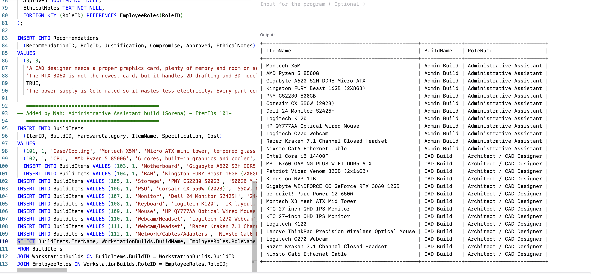

# SQL Queries: Evidence

**Mini Project 1: Northwest Architecture Studio** · Nah'Kajsha Reid

Every query below was run on OneCompiler (MySQL) on 01/10/2026, on the team database built from the brief's ER diagram (page 7). Screenshots are in `Evidence/SQL_Queries`.

---

## Part A: Reading single tables

### Query 1: List every role
```sql
SELECT * FROM EmployeeRoles;
```
This query shows all 4 job roles from the EmployeeRoles table. The `*` means everything (every column), so I don't have to write out every column name.


### Query 2: Just the names and budgets
```sql
SELECT RoleName, BudgetPerUnit FROM EmployeeRoles;
```
This query shows only the role name and budget for all 4 roles. Instead of using `*`, I wrote the names of the 2 columns I wanted after SELECT.


### Query 3: The higher-budget roles
```sql
SELECT RoleName, BudgetPerUnit FROM EmployeeRoles WHERE BudgetPerUnit > 1000;
```
This query uses WHERE to keep only the roles where the budget per unit is more than £1,000. The Administrative Assistant's budget is £950, which is not more than £1,000, so it was left out, leaving 3 roles.


### Query 4: Roles by team size
```sql
SELECT RoleName, StaffCount FROM EmployeeRoles ORDER BY StaffCount DESC;
```
This query shows each role and how many staff it has, sorted from biggest to smallest. ORDER BY sorts the rows by StaffCount, and DESC puts the biggest team first, so the Architect / CAD Designers (5 staff) are at the top.


### Query 5: Find one build's items
```sql
SELECT * FROM BuildItems WHERE BuildID = 1;
```
This query shows every column for all the items in build 1, which is Sorena's Administrative Assistant build. The `*` means every column, and WHERE BuildID = 1 keeps only the items from build 1, so it showed 12 items, from the Montech case to the Cat6 cable.


### Query 6: Count the items in a build
```sql
SELECT COUNT(*) FROM BuildItems WHERE BuildID = 1;
```
*Explanation to come.*


## Part B: Totals and summaries

### Query 7: Total cost of one build
```sql
SELECT SUM(Cost) FROM BuildItems WHERE BuildID = 1;
```
*Explanation to come.*


### Query 8: Cost of every build
```sql
SELECT BuildID, SUM(Cost) FROM BuildItems GROUP BY BuildID ORDER BY SUM(Cost) DESC;
```
*Explanation to come.*


## Part C: Across tables with JOINs

### Query 9: Which role is each build for?
```sql
SELECT WorkstationBuilds.BuildName, EmployeeRoles.RoleName
FROM WorkstationBuilds
JOIN EmployeeRoles ON WorkstationBuilds.RoleID = EmployeeRoles.RoleID;
```
*Explanation to come.*


### Query 10: Items with their build and role
```sql
SELECT BuildItems.ItemName, WorkstationBuilds.BuildName, EmployeeRoles.RoleName
FROM BuildItems
JOIN WorkstationBuilds ON BuildItems.BuildID = WorkstationBuilds.BuildID
JOIN EmployeeRoles ON WorkstationBuilds.RoleID = EmployeeRoles.RoleID;
```
*Explanation to come.*



### Query 11: Spend per role
```sql
SELECT EmployeeRoles.RoleName, SUM(BuildItems.Cost)
FROM BuildItems
JOIN WorkstationBuilds ON BuildItems.BuildID = WorkstationBuilds.BuildID
JOIN EmployeeRoles ON WorkstationBuilds.RoleID = EmployeeRoles.RoleID
GROUP BY EmployeeRoles.RoleName;
```
*Explanation to come.*


---

## Checking the other tables

```sql
SELECT * FROM Recommendations;
```
*Explanation to come.*


