# SQL Queries: Evidence

**Mini Project 1: Northwest Architecture Studio** · Nah'Kajsha Reid

Every query below was run on OneCompiler (MySQL) on 01/10/2026, on the team database built from the brief's ER diagram (page 7). Screenshots are in `Evidence/SQL_Queries`.

---

## Part A: Reading single tables

### Query 1: List every role
```sql
SELECT * FROM EmployeeRoles;
```
This query shows all 4 job roles from the EmployeeRoles table. The `*` means everything (every column), so I don't have to write out every column name.

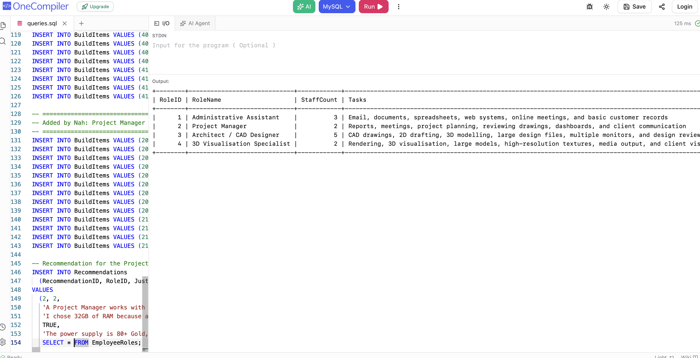
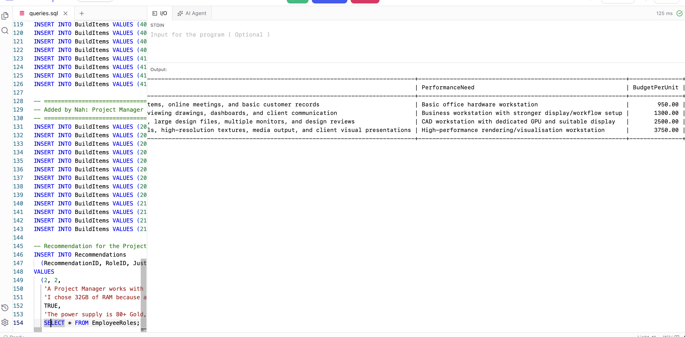

### Query 2: Just the names and budgets
```sql
SELECT RoleName, BudgetPerUnit FROM EmployeeRoles;
```
This query shows only the role name and budget for all 4 roles. Instead of using `*`, I wrote the names of the 2 columns I wanted after SELECT.

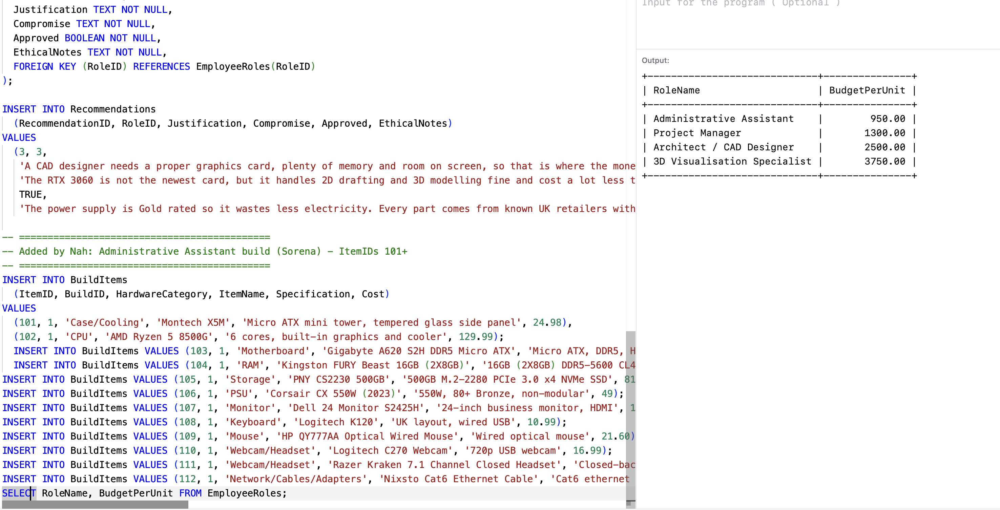

### Query 3: The higher-budget roles
```sql
SELECT RoleName, BudgetPerUnit FROM EmployeeRoles WHERE BudgetPerUnit > 1000;
```
This query uses WHERE to keep only the roles where the budget per unit is more than £1,000. The Administrative Assistant's budget is £950, which is not more than £1,000, so it was left out, leaving 3 roles.

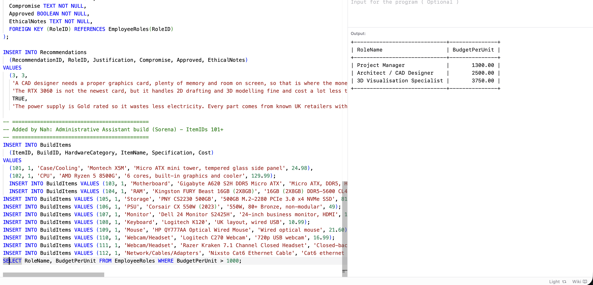

### Query 4: Roles by team size
```sql
SELECT RoleName, StaffCount FROM EmployeeRoles ORDER BY StaffCount DESC;
```
This query shows each role and how many staff it has, sorted from biggest to smallest. ORDER BY sorts the rows by StaffCount, and DESC puts the biggest team first, so the Architect / CAD Designers (5 staff) are at the top.

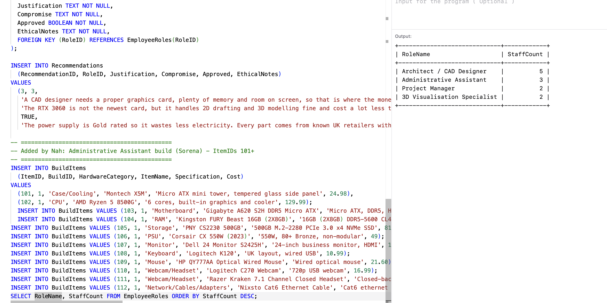

### Query 5: Find one build's items
```sql
SELECT * FROM BuildItems WHERE BuildID = 1;
```
This query shows every column for all the items in build 1, which is Sorena's Administrative Assistant build. The `*` means every column, and WHERE BuildID = 1 keeps only the items from build 1, so it showed 12 items, from the Montech case to the Cat6 cable.

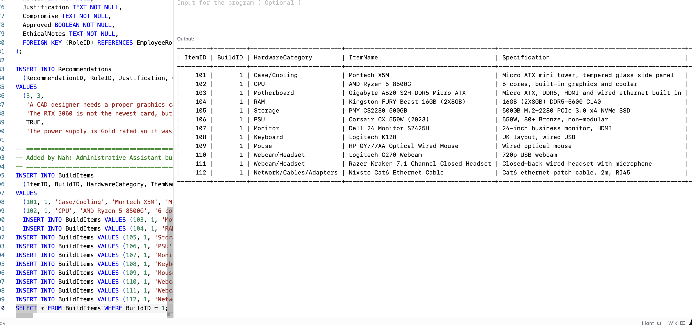
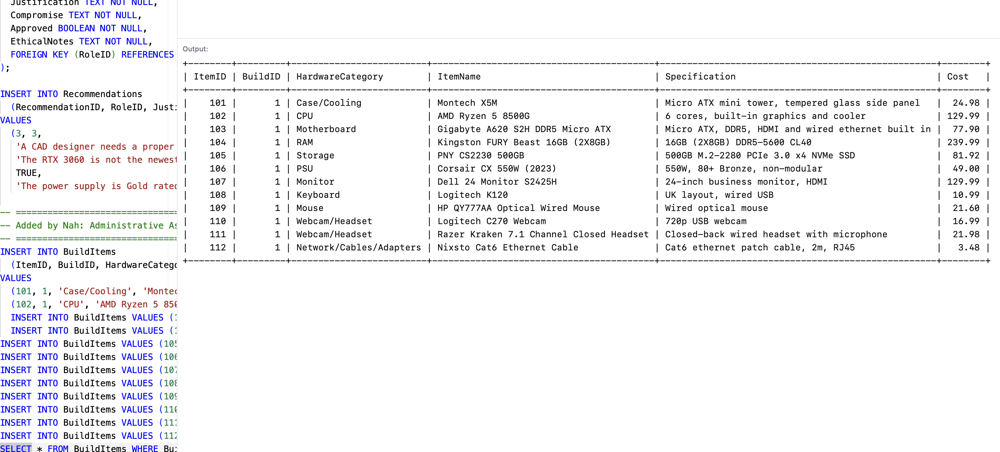

### Query 6: Count the items in a build
```sql
SELECT COUNT(*) FROM BuildItems WHERE BuildID = 1;
```
This query counts how many items are in build 1 (Sorena's Administrative Assistant build). Instead of listing the items, COUNT(\*) counts the rows and gives one number. It showed 12, because there are 12 items in the build. It works like counting the items in a shopping basket.

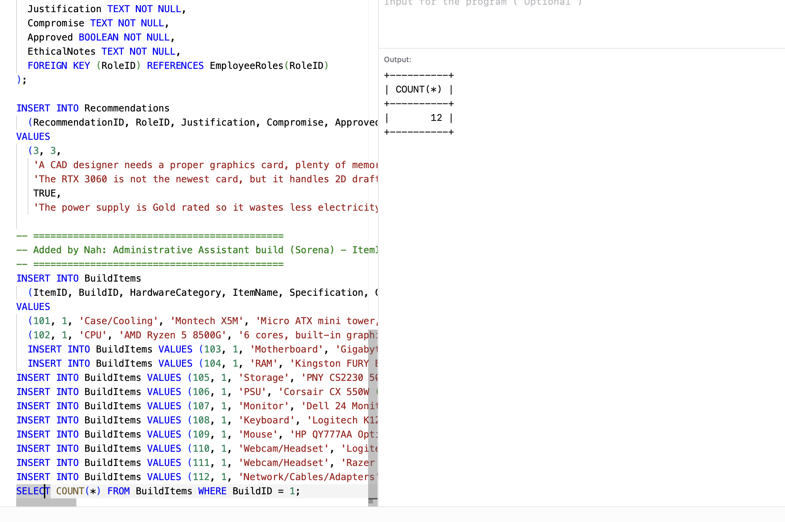

## Part B: Totals and summaries

### Query 7: Total cost of one build
```sql
SELECT SUM(Cost) FROM BuildItems WHERE BuildID = 1;
```
This query adds up the cost of every item in build 1 (Sorena's Administrative Assistant build). COUNT tells the amount of items, but SUM tells the cost, by adding up all the numbers in the Cost column. It showed £808.81, which matches Sorena's total on GitHub, so the database is accurate.

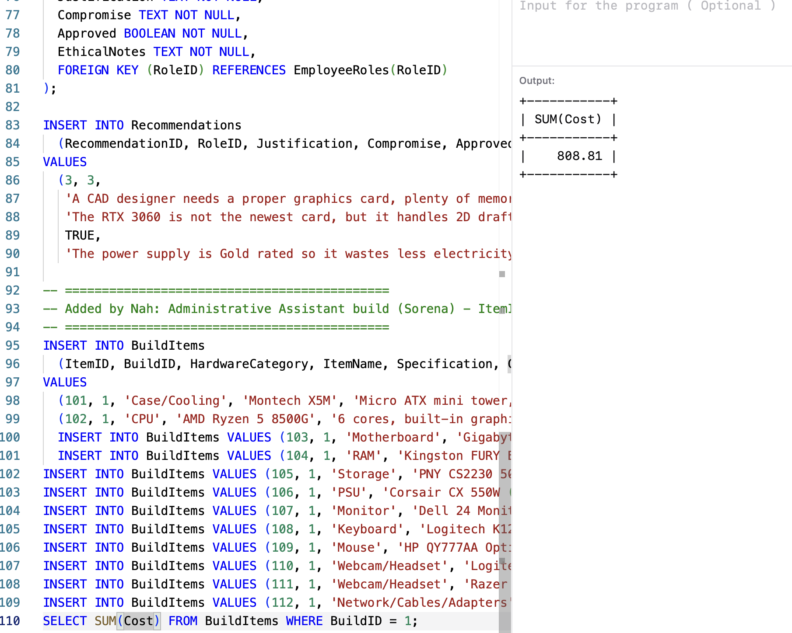

### Query 8: Cost of every build
```sql
SELECT BuildID, SUM(Cost) FROM BuildItems GROUP BY BuildID ORDER BY SUM(Cost) DESC;
```
This query shows the total cost of each build, with the most expensive first. GROUP BY puts the items into a separate group for each build, like a separate shopping basket for each person, and SUM adds up each group. ORDER BY … DESC sorts them biggest first, so build 4 (£3,445.21) is at the top, then build 3 (£1,844.50), then build 1 (£808.81).

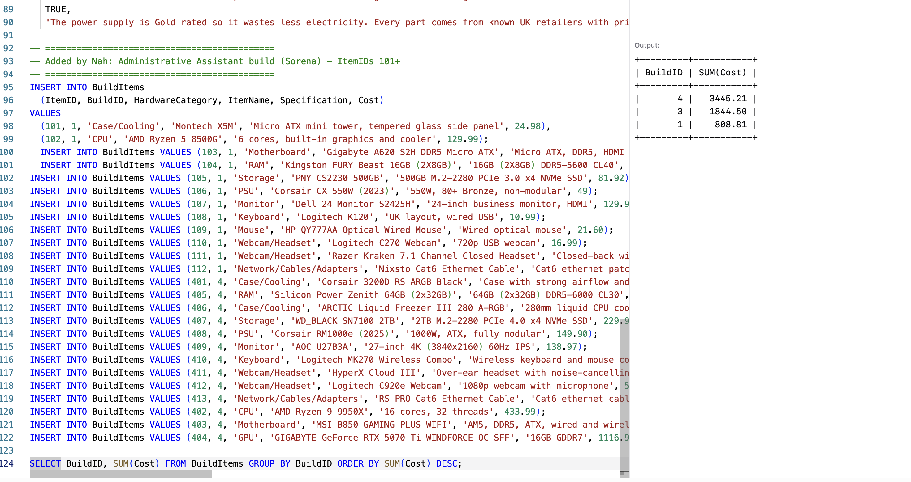

## Part C: Across tables with JOINs

### Query 9: Which role is each build for?
```sql
SELECT WorkstationBuilds.BuildName, EmployeeRoles.RoleName
FROM WorkstationBuilds
JOIN EmployeeRoles ON WorkstationBuilds.RoleID = EmployeeRoles.RoleID;
```
This query shows each build's name next to the role it belongs to. The build names are in the WorkstationBuilds table and the role names are in the EmployeeRoles table, so I used JOIN to combine them. Both tables share the RoleID column, so JOIN matches up the rows with the same RoleID, like matching a locker list to a class register using the student ID.

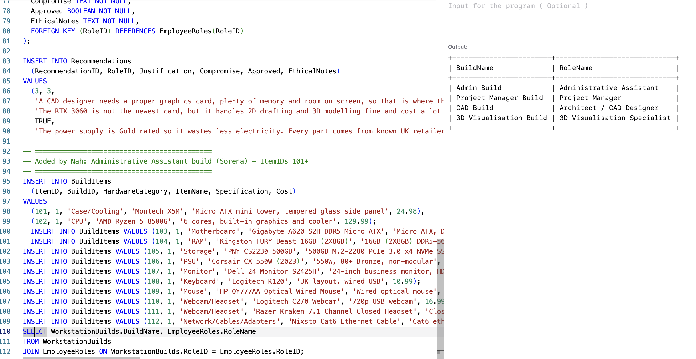

### Query 10: Items with their build and role
```sql
SELECT BuildItems.ItemName, WorkstationBuilds.BuildName, EmployeeRoles.RoleName
FROM BuildItems
JOIN WorkstationBuilds ON BuildItems.BuildID = WorkstationBuilds.BuildID
JOIN EmployeeRoles ON WorkstationBuilds.RoleID = EmployeeRoles.RoleID;
```
This query shows every item with the build it is in and the role that build is for. It links three tables using two JOINs: BuildItems joins to WorkstationBuilds using BuildID, and WorkstationBuilds joins to EmployeeRoles using RoleID. It works like following a chain, from a lost item to its locker to the student's name. It showed 39 items across the three builds.

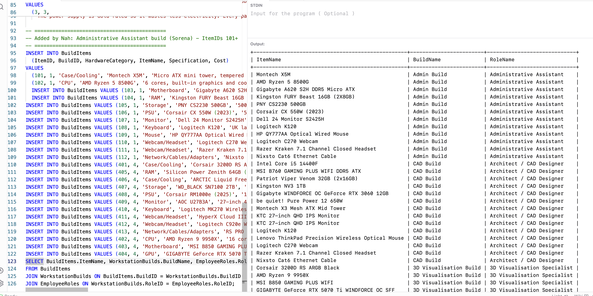
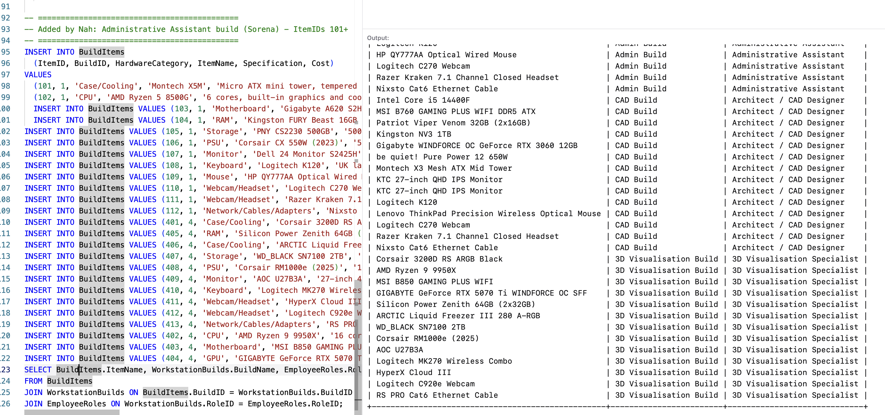

### Query 11: Spend per role
```sql
SELECT EmployeeRoles.RoleName, SUM(BuildItems.Cost)
FROM BuildItems
JOIN WorkstationBuilds ON BuildItems.BuildID = WorkstationBuilds.BuildID
JOIN EmployeeRoles ON WorkstationBuilds.RoleID = EmployeeRoles.RoleID
GROUP BY EmployeeRoles.RoleName;
```
This query shows the total hardware cost for each job role. It uses the same two JOINs as Query 10 to link each item to its build and then to its role. Then GROUP BY makes one group per role, and SUM adds up the costs in each group, like Query 8 but grouped by role instead of by build. The 3D Visualisation Specialist costs the most (£3,445.21), because 3D work needs the most powerful parts.

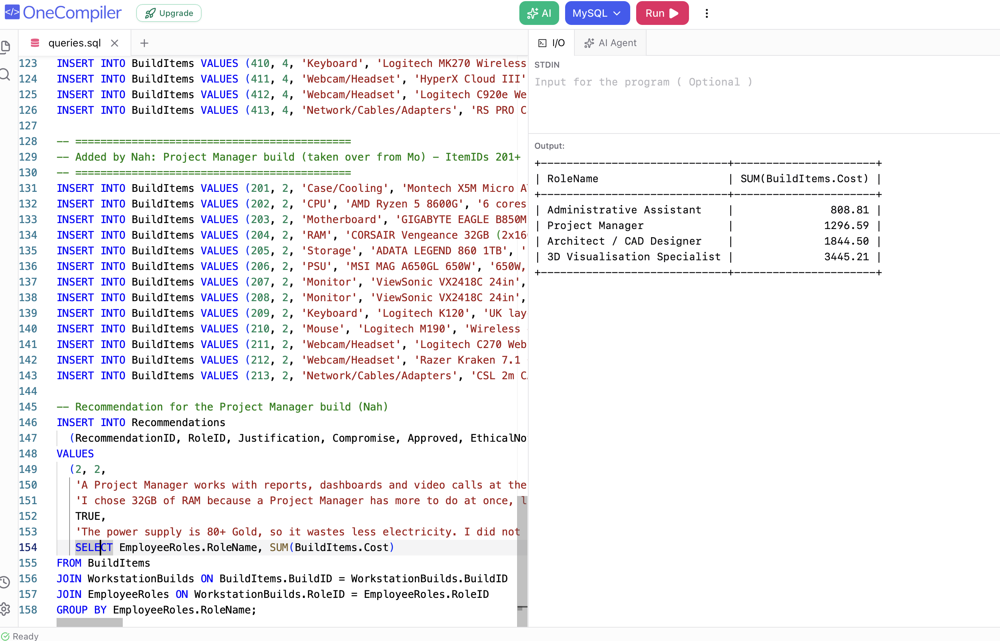

---

## Checking the other tables

```sql
SELECT * FROM Recommendations;
```
This query uses `*` to show every column in the Recommendations table, to check it works, because the brief asks for every table to be queried. It showed 1 row, the recommendation for RoleID 3 (Architect / CAD Designer), which Marcus wrote. The other team members' recommendations have not been added yet.

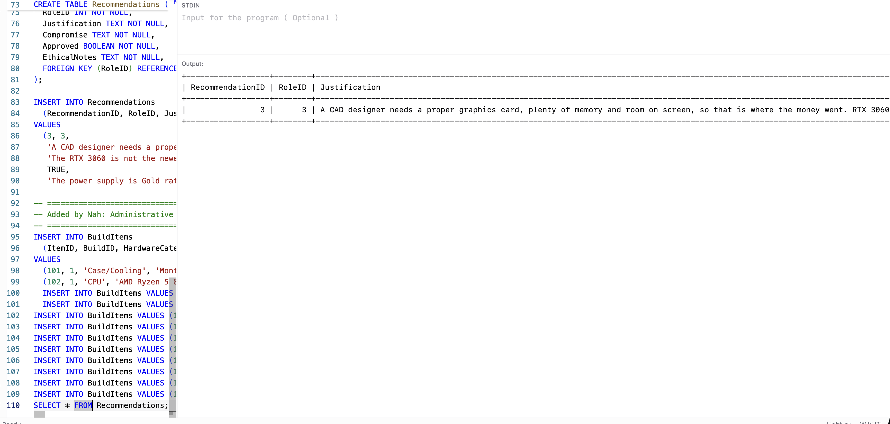
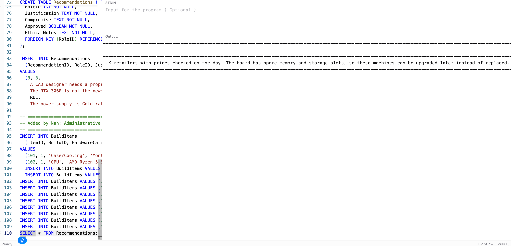
