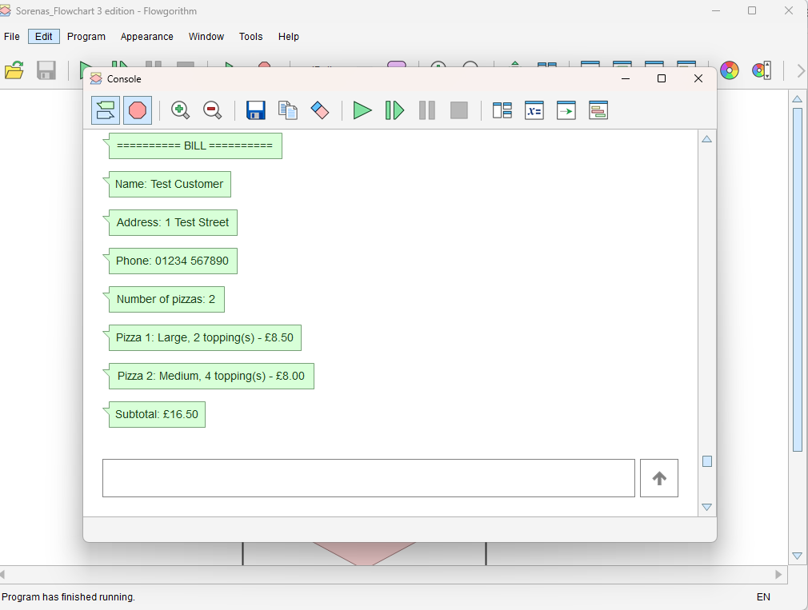
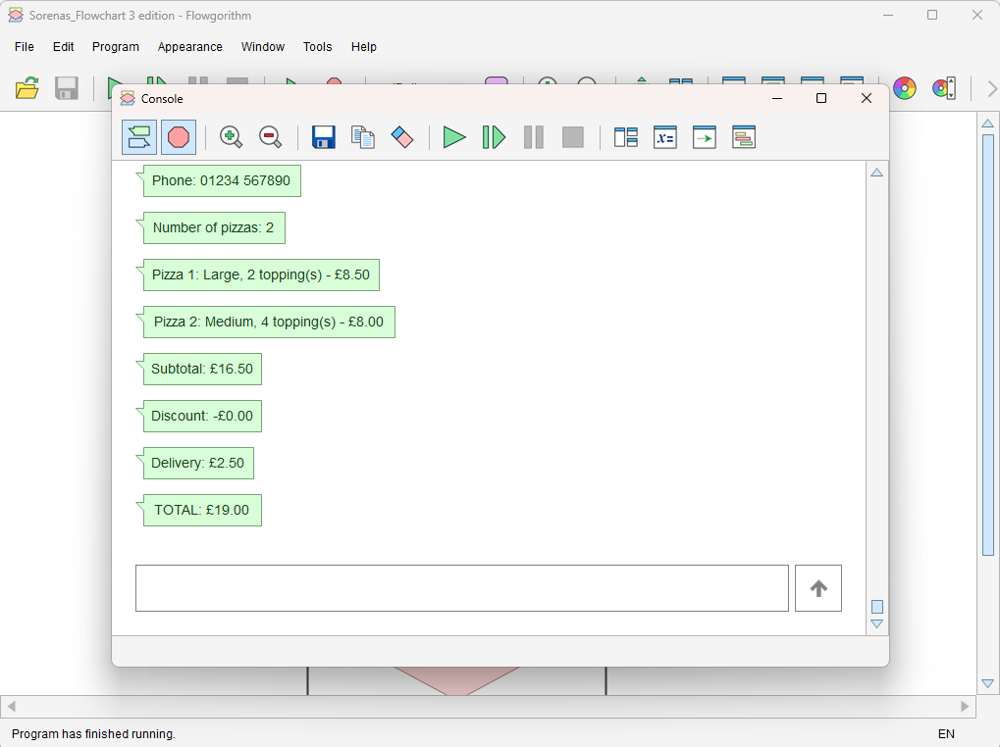

# Pennine Pizza Works: ordering program

**COM4401 Mini Project 2: Software Engineering Fundamentals (team task)**  
**Team:** The Avengers (Team 4): Charlie Broughton, Marcus Weeks, Nah'Kajsha Reid, Sorena Golbarg Lisar  
**Final version:** [Sorenas_Flowchart_v3.fprg](02_Contributions/Sorena_Build/Sorenas_Flowchart_v3.fprg)

## 1. The problem

Pennine Pizza Works is a small takeaway. Staff write each order on paper and work out the price on a calculator, and they sometimes get the total, the discount or the delivery charge wrong. The owner wanted a simple program, built in Flowgorithm, that works out each order without mistakes and prints an itemised bill.

## 2. How to run the program

1. Download Flowgorithm from the official site: [flowgorithm.org/download](http://www.flowgorithm.org/download/). It's free and runs on Windows. The current version is 4.5.
2. Download [Sorenas_Flowchart_v3.fprg](02_Contributions/Sorena_Build/Sorenas_Flowchart_v3.fprg) from this repository. If your browser saves it as a *.txt* file, rename it so it ends in *.fprg*, or Flowgorithm won't open it.
3. Open the file in Flowgorithm and press **Run**. The console window opens.
4. Answer each question in the console:
   - the customer's name, address and phone number
   - how many pizzas (1 to 6)
   - for each pizza, the size (0 = Small, 1 = Medium, 2 = Large) and the number of extra toppings
   - whether the customer wants delivery (Y or N)
5. The program prints the bill.

## 3. Business rules

| Item | Rule |
|---|---|
| Number of pizzas | 1 to 6 |
| Small pizza | £3.25 |
| Medium pizza | £5.50 |
| Large pizza | £7.15 |
| 1 extra topping | £0.75 |
| 2 extra toppings | £1.35 |
| 3 extra toppings | £2.00 |
| 4 or more extra toppings | £2.50 |
| Discount | 10% if the subtotal is over £20, before delivery |
| Delivery | £2.50 if the customer asks for it |

## 4. How the program is built

Main sets up the prices, then calls six functions in order. A helper function works out the price of one pizza.

| Function | What it does |
|---|---|
| getCustomerDetails() | Asks for the name, address and phone number |
| getPizzas() | Asks how many pizzas (1 to 6) |
| choosePizzas() | Asks for the size and toppings of each pizza |
| getDelivery() | Asks Y or N for delivery |
| calcTotals() | Works out the subtotal, discount, delivery charge and total |
| displayBill() | Prints the bill |
| pizzaPrice() | Helper: size price plus topping price for one pizza, used by 3 functions |

The prices are kept in arrays. The customer's choice is the index, so each price is one lookup, for example `sizePrice[size]`. Any number of toppings from 4 upwards uses the £2.50 price.

## 5. Input checks

Each check is a while loop. It shows the message and keeps asking until the input is valid.

| Input | Rule | Message shown |
|---|---|---|
| Name, address, phone | Cannot be blank | "This cannot be blank, try again!" |
| Number of pizzas | 1 to 6 | "Error, must be between 1 and 6!" |
| Pizza size | 0, 1 or 2 | "Invalid choice. Please enter an ID from 0 to 2" |
| Toppings | 0 or more | "Invalid. Toppings cannot be less than 0" |
| Delivery | Y or N | "Please enter Y or N" |

## 6. The program running

A normal order (Test 1 on the final version): a Large pizza with 2 toppings and a Medium with 4, with delivery. The bill comes to £19.00.

A rounding check: an order of £20.05 gets a discount of £2.005, which the program rounds to £2.01 before working out the total. The bill comes to £18.04.

## 7. Testing and versions

Nah tested the program against the test plan in the design, with normal, abnormal and extreme (boundary) data: 18 tests over three rounds. The full results and screenshots are in [MP2_Test_Log_Nah.md](02_Contributions/Nah_Testing/MP2_Test_Log_Nah.md).

| Version | What changed | Test result |
|---|---|---|
| v1 | First full version | 5 passed, 11 failed, 2 recorded without an expected result |
| v2 | Phone number instead of payment details; phone and number of pizzas on the bill; 4 or more toppings cost £2.50; discount rounded first; sizes 0 to 2, as in the design | Every main fault fixed; some error messages still worded differently from the design |
| v3 | Error messages word for word as in the design; blank check added to address and phone | Every test that failed in the first round now passes |

## 8. Where to find each stage

| Stage | What | File | Who |
|---|---|---|---|
| Analysis | Requirements table and IPO chart | [Charlie_Analysis.md](02_Contributions/Charlie_Analysis/Charlie_Analysis.md) | Charlie |
| Design | Function list, main program flow, flowcharts, test plan | [Design_Pennine_Pizza.md](02_Contributions/Marcus_Design/Design_Pennine_Pizza.md) ([PDF](02_Contributions/Marcus_Design/Design_Pennine_Pizza.pdf), [Word](02_Contributions/Marcus_Design/Design_Pennine_Pizza.docx), [draw.io](02_Contributions/Marcus_Design/PenninePizzaDesign.drawio)) | Marcus |
| Build | Flowgorithm program, final version | [Sorenas_Flowchart_v3.fprg](02_Contributions/Sorena_Build/Sorenas_Flowchart_v3.fprg) | Sorena |
| Test | Test log, retests and screenshots | [MP2_Test_Log_Nah.md](02_Contributions/Nah_Testing/MP2_Test_Log_Nah.md) | Nah |
| Deploy | This page: how to run the program | README.md | Marcus |
| Team evidence | Who did what (RACI) | [Team_Work_Allocation_Software.md](02_Contributions/Team_Work_Allocation_Software.md) | Whole team |
| Individual evidence | Role, learning, study methods and reflection | [Charlie](02_Contributions/Charlie_Analysis/Charlie_Analysis.md) (sections 4 to 7), [Marcus](02_Contributions/Marcus_Design/Reflection_MP2_Marcus.md), [Nah](02_Contributions/Nah_Testing/Reflection_MP2_Nah.md) | Each member |
