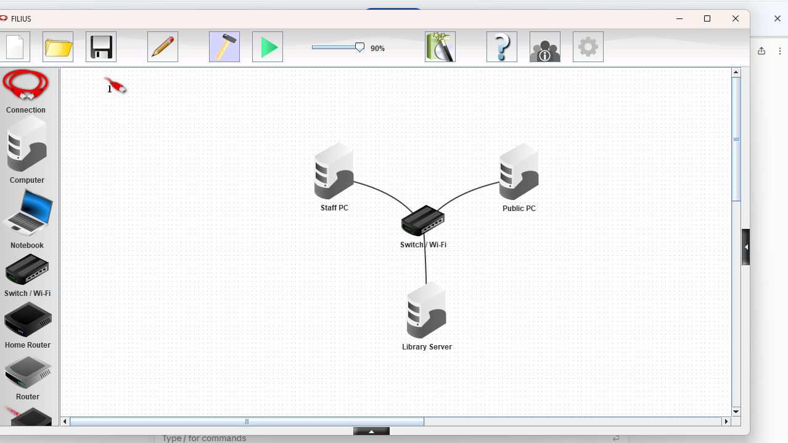
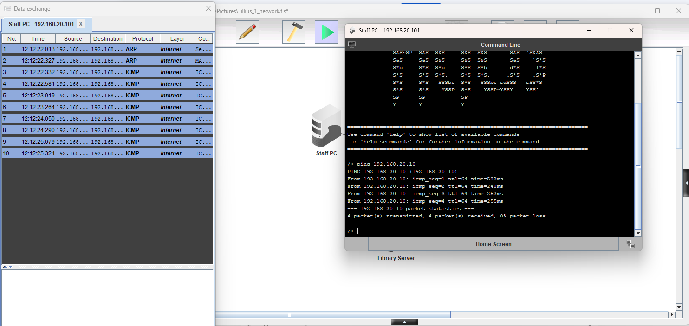
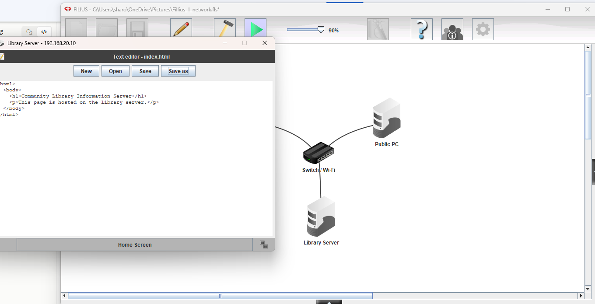
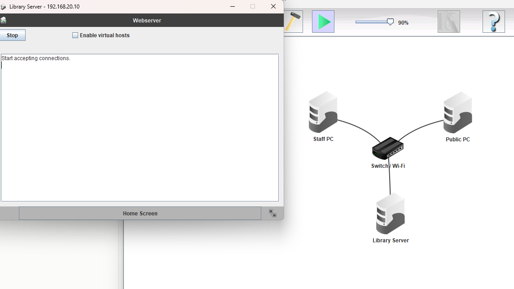
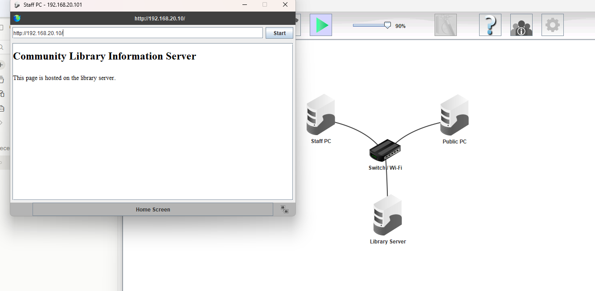
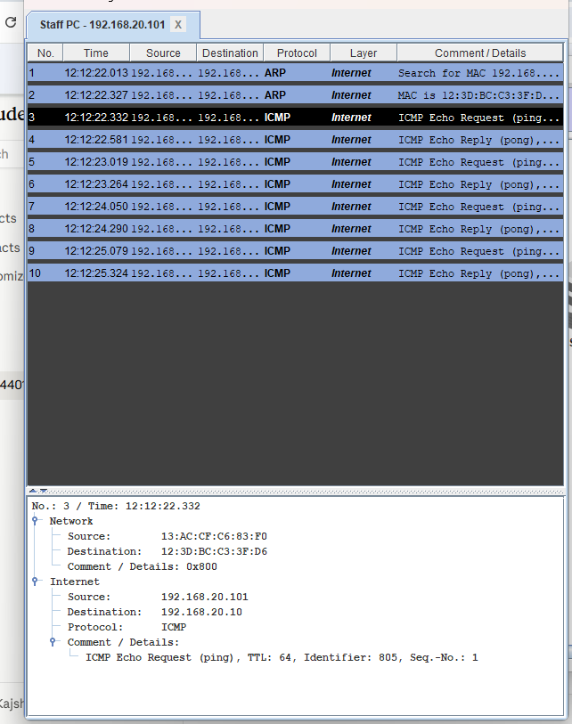
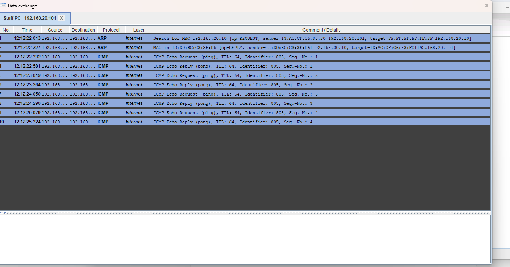
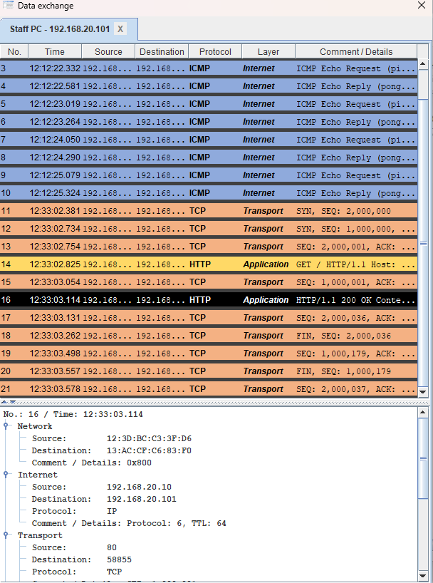
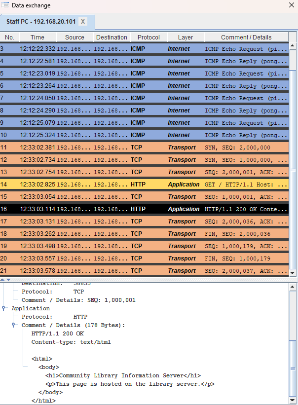
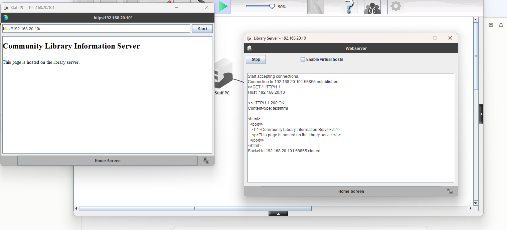

# Filius Practice: Community Library Network

**Nah'Kajsha Reid · Mini Project 3: Networking Fundamentals (individual practice task)**

Practice task from the Week 3 slides *W3-COM4401-Filius_Community_Library_Network_Guide*. Completed on 7 October 2026 in Filius 2.14 (Windows).

---

## 1. The network

One small LAN: three computers connected to one switch. Gateway and DNS were left blank, because all three devices are on the same network.

| Device | IP address | Subnet mask |
|---|---|---|
| Library Server | 192.168.20.10 | 255.255.255.0 |
| Staff PC | 192.168.20.101 | 255.255.255.0 |
| Public PC | 192.168.20.102 | 255.255.255.0 |

**Screenshot 1: the three named computers cabled to the switch**

---

## 2. Tests

### Test 1: ping from the Staff PC to the Library Server

Command: `ping 192.168.20.10`
Result: 4 packets transmitted, 4 packets received, 0% packet loss.

**Screenshot 2: ping replies**

### Test 2: web page from the Library Server, opened on the Staff PC

The Webserver and Text editor were installed on the Library Server, the page was saved as `index.html` in the webserver folder, and the Webserver was started. The Staff PC's Web Browser then opened `http://192.168.20.10`.

**Screenshot 3: the library page in the Staff PC's browser**

---

## 3. Protocols seen in the Data Exchange window

| Protocol | Screenshot | Top layer (Filius) | What it did |
|---|---|---|---|
| ARP | A | Internet* | ARP found the MAC address of the Library Server, so that the Staff PC could send the ping to the right local device. |
| ICMP | A, 2 | Internet | ICMP sent echo requests to check that the Library Server could be reached, and the Library Server sent echo replies to show it was there. |
| TCP | B | Transport | TCP set up a reliable connection using a 3-way handshake before the web page was sent, so that the web page arrived complete and in the right order. |
| HTTP | B | Application | HTTP was used by the Staff PC's browser to request the web page (GET), and the Library Server replied with "200 OK" and sent the index.html page. |

\*Filius shows ARP as "Internet"; the slides place it at the Network (link) layer.

**Screenshot A: ARP and ICMP (ping), with an ICMP row opened**

**Screenshot B: TCP and HTTP (web page), with an HTTP row opened**

---

## 4. Why did ping use fewer layers than loading the web page?

Ping used fewer layers because it only needed to check that the Library Server was there and could be reached. Loading the web page used more layers because it needed the Transport layer (TCP) for a reliable connection, and the Application layer (HTTP) to request and send the page. This shows encapsulation, because the more a task needs, the more layers it goes through, and the more headers are added to the data.

---

## 5. Client and server

In this network, the Staff PC was the client, because it sent a request for the web page. The Library Server was the server, because it sent the web page back. The ping proved that the Staff PC could reach the Library Server across the network, and loading the web page proved that the Library Server sent the web page back to the client.
