# NorthWest Architecture Studio Network

**COM4401 Mini Project 3: Networking Fundamentals (team task)**  
**Team:** The Avengers (Team 4): Charlie Broughton, Marcus Weeks, Nah'Kajsha Reid, Sorena Golbarg Lisar  
**Date:** 9 October 2026

Downloads: [evidence document (PDF)](Northwest_Network_Evidence.pdf), [Word version](Northwest_Network_Evidence.docx), [Filius file](Team_Network.fls)  
Who did what: [team work allocation](../Team_Work_Allocation_Networking.md)

## 1. Topology

### Screenshot 1: the whole network

The office LAN (192.168.10.0/24) and the external / ISP network (203.0.113.0/24), joined by the Office Router.

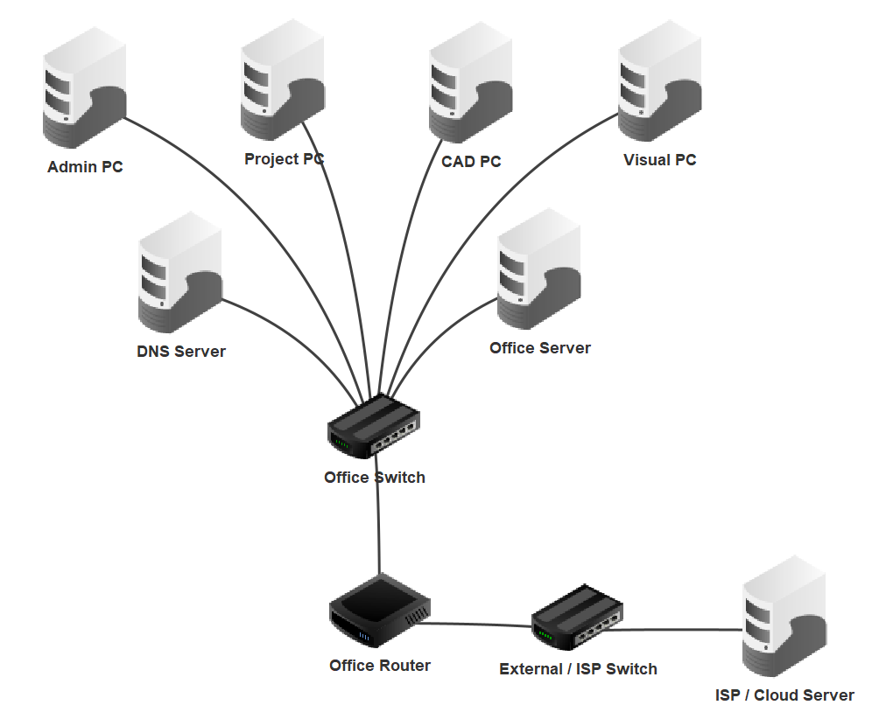

*Screenshot 1: the four staff PCs, the DNS Server and the Office Server on the Office Switch; the Office Router joins the Office Switch to the External / ISP Switch and the ISP / Cloud Server.*

## 2. IP addressing table

| Device | IP address | Subnet mask | Gateway | DNS |
|--------------------|--------------|---------------|--------------|--------------|
| Office Router (office side) | 192.168.10.1 | 255.255.255.0 | none | none |
| Office Router (external side) | 203.0.113.1 | 255.255.255.0 | none | none |
| DNS Server | 192.168.10.2 | 255.255.255.0 | 192.168.10.1 | 192.168.10.2 |
| Office Server | 192.168.10.10 | 255.255.255.0 | 192.168.10.1 | 192.168.10.2 |
| Admin PC | 192.168.10.101 | 255.255.255.0 | 192.168.10.1 | 192.168.10.2 |
| Project PC | 192.168.10.111 | 255.255.255.0 | 192.168.10.1 | 192.168.10.2 |
| CAD PC | 192.168.10.121 | 255.255.255.0 | 192.168.10.1 | 192.168.10.2 |
| Visual PC | 192.168.10.131 | 255.255.255.0 | 192.168.10.1 | 192.168.10.2 |
| ISP / Cloud Server | 203.0.113.10 | 255.255.255.0 | 203.0.113.1 | 192.168.10.2 |

The two switches have no IP address.

### DNS records

| DNS name | Points to | Meaning |
|-------------------------|--------------|--------------------------|
| intranet.archstudio.local | 192.168.10.10 | Internal office intranet server |
| cloud.archstudio.example | 203.0.113.10 | External cloud service server |

## 3. Router interfaces

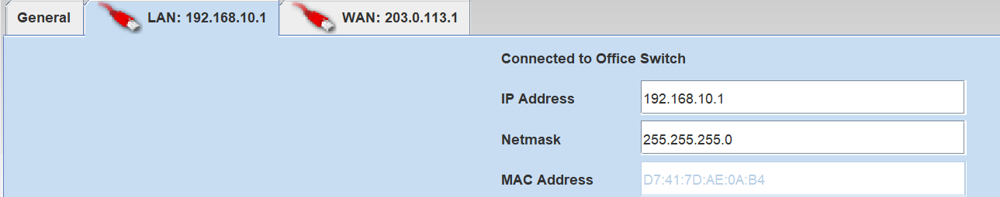

*Screenshot 2: the Office Router's office side (LAN), 192.168.10.1 / 255.255.255.0, connected to the Office Switch.*

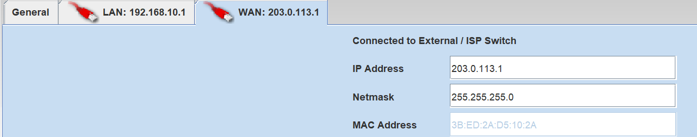

*Screenshot 3: the Office Router's external side (WAN), 203.0.113.1 / 255.255.255.0, connected to the External / ISP Switch.*

## 4. DNS records

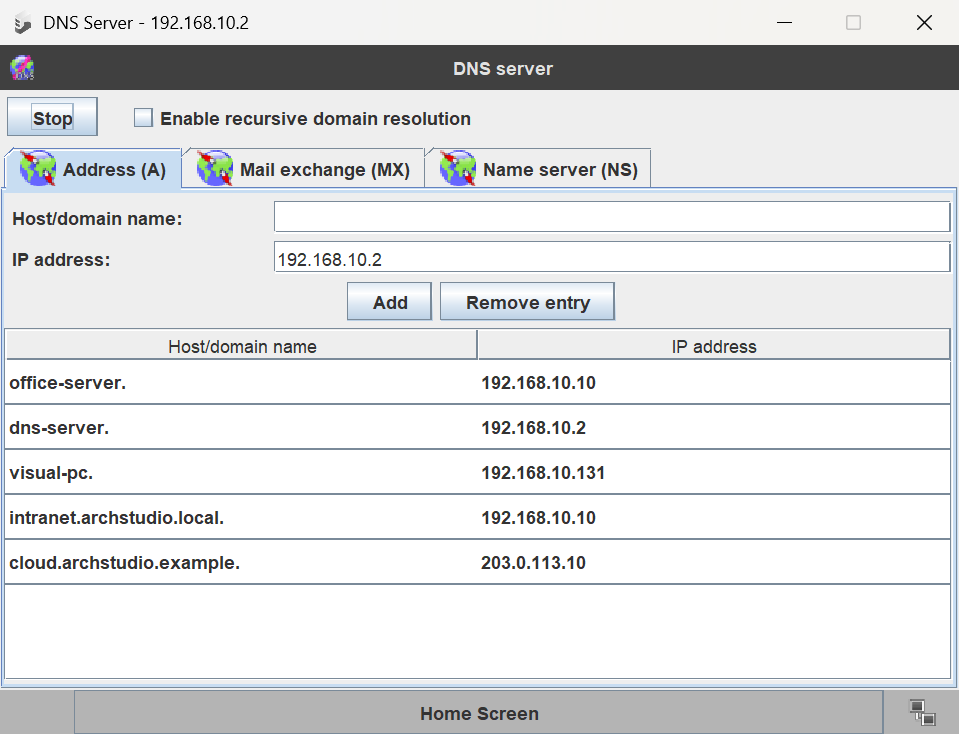

*Screenshot 4: the DNS Server's address (A) records, including intranet.archstudio.local → 192.168.10.10 and cloud.archstudio.example → 203.0.113.10.*

## 5. Web pages opening from the CAD PC

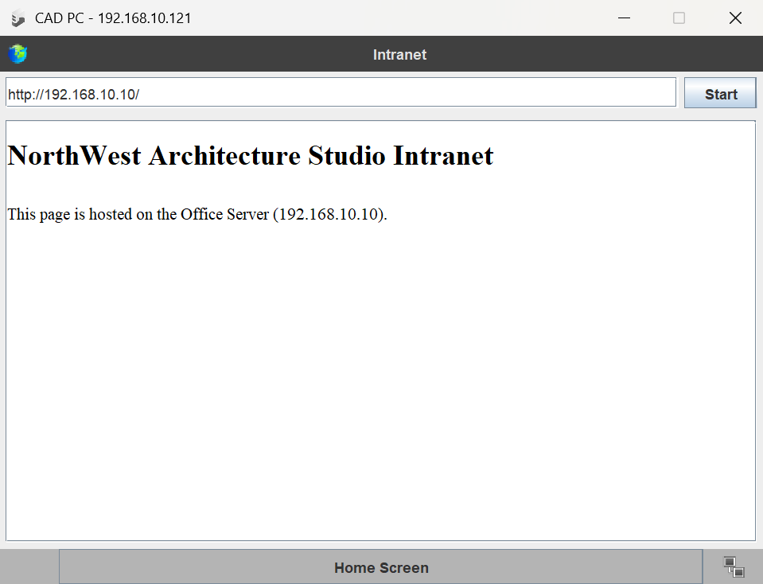

*Screenshot 5 (test 4): the CAD PC's browser opening the intranet page from http://192.168.10.10.*

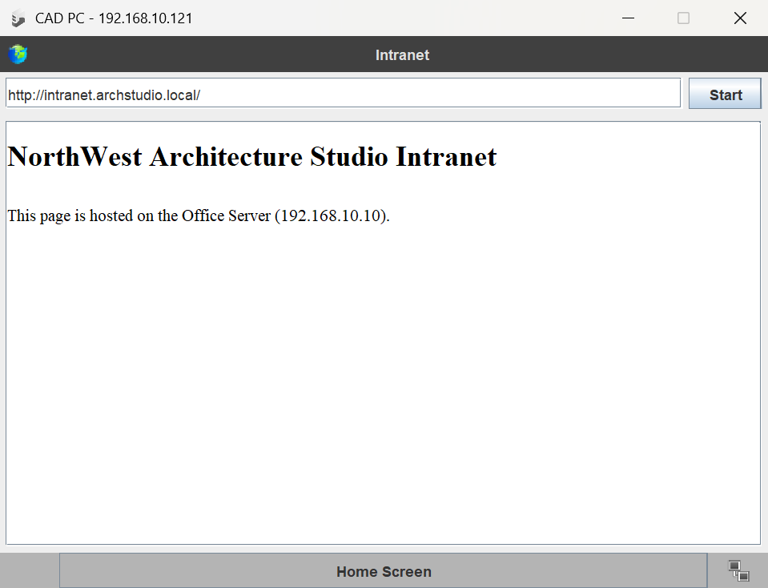

*Screenshot 6 (test 5): the same intranet page opened by name, http://intranet.archstudio.local.*

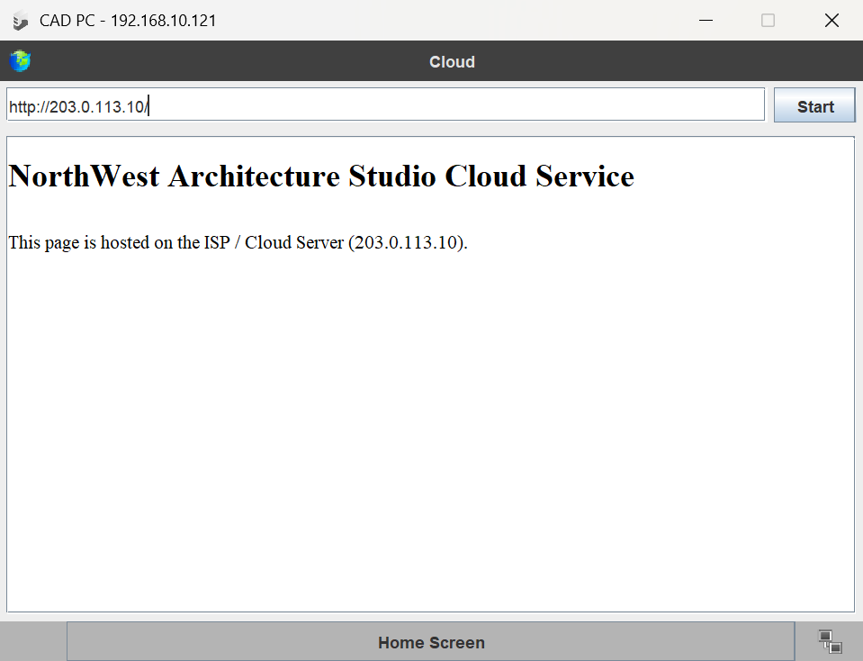

*Screenshot 7 (test 7): the CAD PC's browser opening the cloud page from http://203.0.113.10, through the Office Router.*

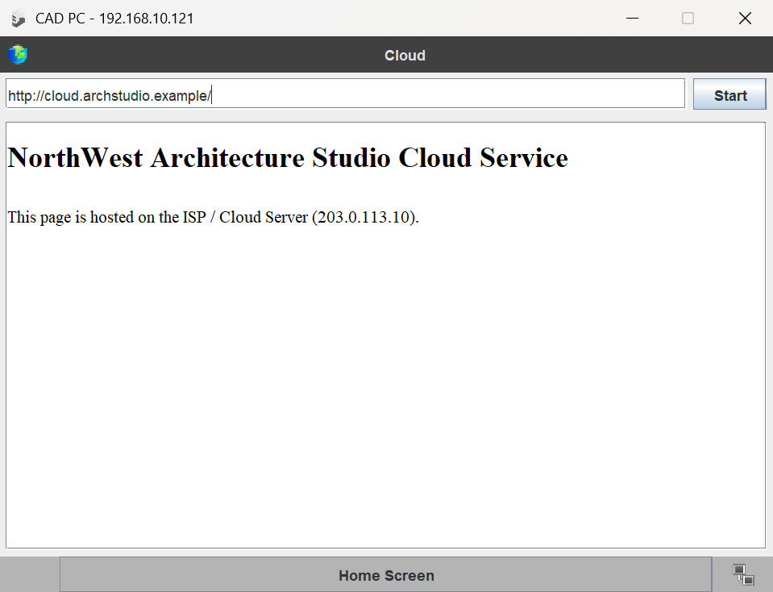

*Screenshot 8 (test 8): the same cloud page opened by name, http://cloud.archstudio.example.*

## 6. Ping tests from the CAD PC

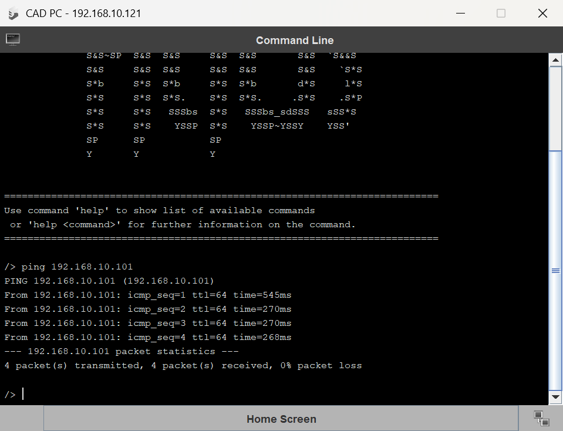

*Screenshot 9 (test 1): ping 192.168.10.101 (Admin PC), 4 of 4 replies, 0% packet loss.*

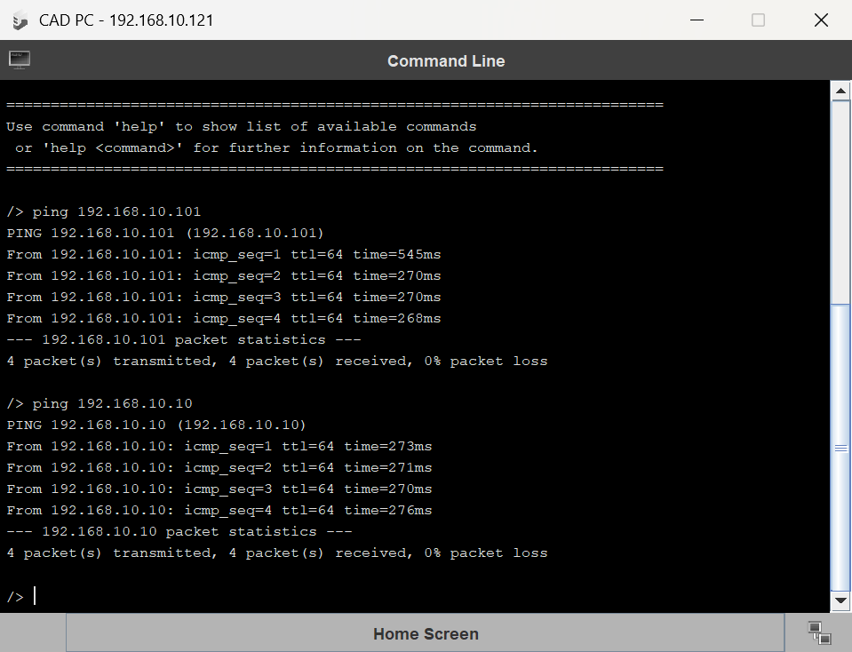

*Screenshot 10 (test 2): ping 192.168.10.10 (Office Server), shown at the bottom of the window, 4 of 4 replies, 0% packet loss.*

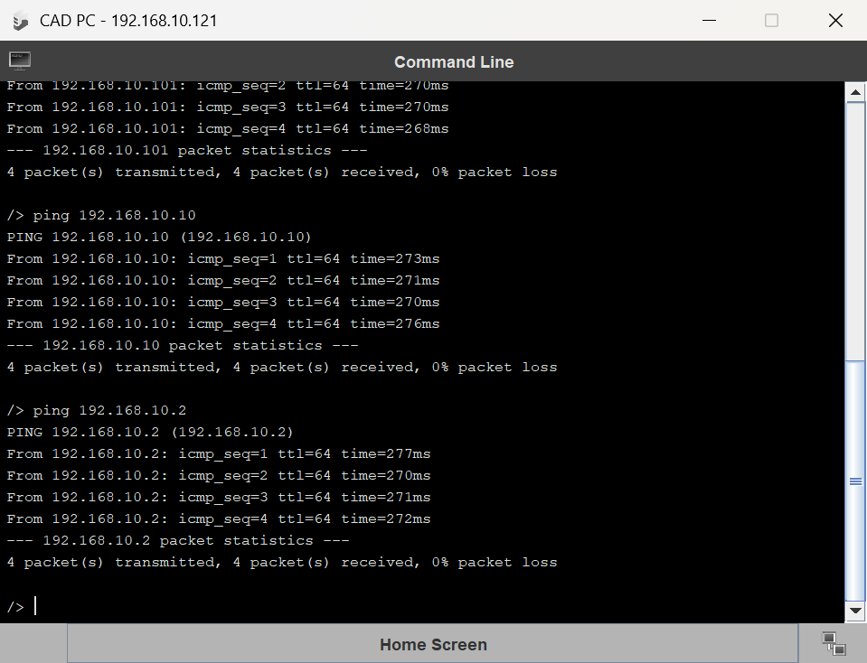

*Screenshot 11 (test 3): ping 192.168.10.2 (DNS Server), shown at the bottom of the window, 4 of 4 replies, 0% packet loss.*

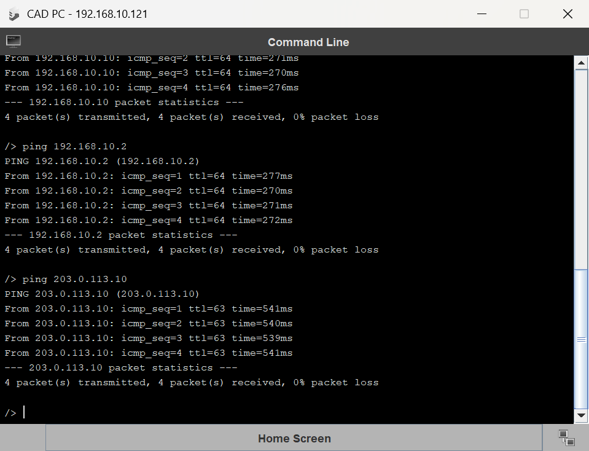

*Screenshot 12 (test 6): ping 203.0.113.10 (ISP / Cloud Server on the external network), shown at the bottom of the window, 4 of 4 replies, 0% packet loss.*

## 7. Testing table

All tests were run from the CAD PC.

| No. | Test | Command / action | Expected result | What it proves | Actual result | Pass / Fail |
|--------|--------------|--------------------------|--------------------------|--------------------------|--------------------------|--------|
| 1 | LAN PC to PC | ping 192.168.10.101 | 4 replies from 192.168.10.101, 0% packet loss | Office LAN devices communicate through the switch | 4 of 4 replies from 192.168.10.101, 0% packet loss (Screenshot 9) | Pass |
| 2 | PC to Office Server | ping 192.168.10.10 | 4 replies from 192.168.10.10, 0% packet loss | The client can reach the internal server | 4 of 4 replies from 192.168.10.10, 0% packet loss (Screenshot 10) | Pass |
| 3 | PC to DNS Server | ping 192.168.10.2 | 4 replies from 192.168.10.2, 0% packet loss | The client can reach the DNS service | 4 of 4 replies from 192.168.10.2, 0% packet loss (Screenshot 11) | Pass |
| 4 | Internal web by IP | http://192.168.10.10 | The Office Server's index.html page opens | HTTP client-server works inside the office | Intranet page opened (Screenshot 5) | Pass |
| 5 | Internal web by name | http://intranet.archstudio.local | The same Office Server page opens | DNS turns the internal name into its IP address | Same intranet page opened by name (Screenshot 6) | Pass |
| 6 | External server ping | ping 203.0.113.10 | 4 replies from 203.0.113.10, 0% packet loss | The router connects the office LAN to the external network | 4 of 4 replies from 203.0.113.10, 0% packet loss (Screenshot 12) | Pass |
| 7 | External web by IP | http://203.0.113.10 | The ISP / Cloud Server's index.html page opens | The client can use an external service | Cloud page opened (Screenshot 7) | Pass |
| 8 | External web by name | http://cloud.archstudio.example | The same ISP / Cloud Server page opens | DNS turns the external service name into its IP address | Same cloud page opened by name (Screenshot 8) | Pass |

## 8. Protocols and concepts

| Concept | Where it appears in our network | What it does |
|--------------|------------------------------|----------------------------------------|
| IP addressing | Every device has its own address, for example the CAD PC is 192.168.10.121 and the ISP / Cloud Server is 203.0.113.10 | IP carries the sender and destination address in each packet, so each packet can be sent toward the right place (Postel, 1981b). |
| Subnet mask | 255.255.255.0 on both networks | A computer uses the mask to compare the destination address with its own. If the network parts match, it sends the packet straight to that device. If they do not match, it sends the packet to the gateway (Mogul and Postel, 1985). |
| Gateway | The office devices use 192.168.10.1 and the ISP / Cloud Server uses 203.0.113.1 | The gateway is where a device sends packets bound for another network (Mogul and Postel, 1985). In our network the gateway is the Office Router. |
| DNS | The DNS Server (192.168.10.2) holds intranet.archstudio.local and cloud.archstudio.example | DNS turns a host name into an IP address, and the name server answers each question from the records it holds (Mockapetris, 1987). Tests 5 and 8 opened both pages by name. |
| HTTP | The CAD PC's web browser opening the two web pages (tests 4, 5, 7 and 8) | The browser sends an HTTP request and the web server replies with an HTTP response that carries the page (MDN Web Docs, 2026). |
| ICMP / ping | Tests 1, 2, 3 and 6 from the CAD PC | Ping sends an ICMP echo message, and the other device has to send the same data back in an echo reply (Postel, 1981a). Every ping got 4 of 4 replies. |

## 9. LAN vs external network, and the client-server model

The office LAN is 192.168.10.0/24. It holds the four staff PCs, the DNS Server and the Office Server, all plugged into the Office Switch. A LAN is a set of devices connected together in one place, such as an office (Cisco, N.D.a). Addresses starting 192.168 are private, so any company can use them inside its own network, and they are only unique inside that company (Rekhter et al., 1996).

The outside network is 203.0.113.0/24. It holds only the ISP / Cloud Server on the External / ISP Switch, and it stands in for the internet. That block of addresses is kept for examples and should not appear on the real internet (Arkko et al., 2010), which makes it a safe choice for a simulation.

The Office Router joins the two networks. It has an address on each side: 192.168.10.1 for the office and 203.0.113.1 for the outside. Every office device uses 192.168.10.1 as its gateway. The router reads the destination IP address in each packet and chooses the route it takes (Cisco, N.D.b).

In the web page tests, the CAD PC is the client. It runs the web browser and asks for the page. The Office Server and the ISP / Cloud Server are the servers, because they run the web server software, wait for requests and send pages back. The browser sends an HTTP request and the server replies with an HTTP response that carries the page (MDN Web Docs, 2026).

## 10. Troubleshooting log

| | |
|---|---|
| **Fault** | The ISP / Cloud Server could not send out a web page. |
| **How we found it** | When we finished the network, we opened the ISP / Cloud Server in Filius to check its software. It had none at all: no web server and no page. |
| **Why it mattered** | Tests 7 and 8 ask the CAD PC's browser to open a page from the ISP / Cloud Server. A browser needs a web server to answer its HTTP request (MDN Web Docs, 2026), so with nothing running there, both tests would fail. |
| **Fix** | We installed the Web Server and the Text Editor on the ISP / Cloud Server, wrote its index.html page and switched the web server on. |
| **Retest** | Test 7 (http://203.0.113.10) and test 8 (http://cloud.archstudio.example) both opened the cloud page (Screenshots 7 and 8). Both passed. |
| **Proof of the change** | In Charlie's first file, [Northwest Architecture Studio Network.fls](../Charlie_LAN_Design/Northwest%20Architecture%20Studio%20Network.fls), the ISP / Cloud Server has no software. In the finished file, [Team_Network.fls](Team_Network.fls), it has the Web Server, the Text Editor and the page. |

## References

Arkko, J., Cotton, M. and Vegoda, L. (2010) *IPv4 address blocks reserved for documentation.* [Online] RFC Editor. Available from: https://www.rfc-editor.org/rfc/rfc5737.html. [Accessed 9 October 2026].

Cisco. (N.D.a) *What is a LAN? Local area network.* [Online] Available from: https://www.cisco.com/site/us/en/learn/topics/networking/what-is-a-lan-local-area-network.html. [Accessed 9 October 2026].

Cisco. (N.D.b) *What is a router?* [Online] Available from: https://www.cisco.com/site/us/en/learn/topics/small-business/what-is-a-router.html. [Accessed 9 October 2026].

MDN Web Docs. (2026) *Client-server overview.* [Online] Available from: https://developer.mozilla.org/en-US/docs/Learn_web_development/Extensions/Server-side/First_steps/Client-Server_overview. [Accessed 9 October 2026].

Mockapetris, P. (1987) *Domain names: concepts and facilities.* [Online] RFC Editor. Available from: https://www.rfc-editor.org/rfc/rfc1034.html. [Accessed 9 October 2026].

Mogul, J. and Postel, J. (1985) *Internet standard subnetting procedure.* [Online] RFC Editor. Available from: https://www.rfc-editor.org/rfc/rfc950.html. [Accessed 9 October 2026].

Postel, J. (1981a) *Internet control message protocol.* [Online] RFC Editor. Available from: https://www.rfc-editor.org/rfc/rfc792.html. [Accessed 9 October 2026].

Postel, J. (1981b) *Internet protocol.* [Online] RFC Editor. Available from: https://www.rfc-editor.org/rfc/rfc791.html. [Accessed 9 October 2026].

Rekhter, Y., Moskowitz, B., Karrenberg, D., de Groot, G. J. and Lear, E. (1996) *Address allocation for private internets.* [Online] RFC Editor. Available from: https://www.rfc-editor.org/rfc/rfc1918.html. [Accessed 9 October 2026].
